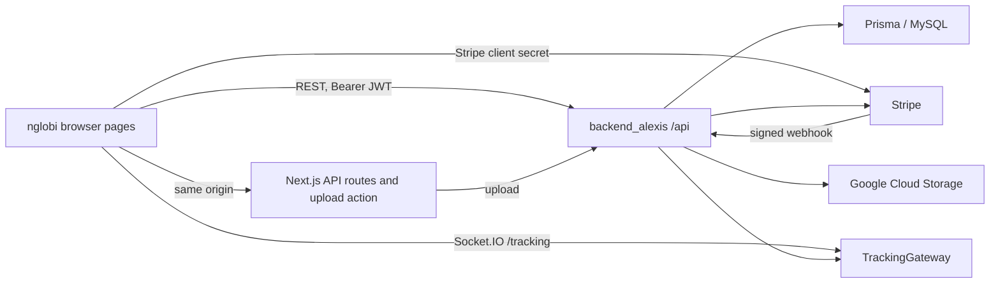

# nglobi ↔ backend_alexis integration and business risk audit

Audit date: 2026-11-06. This is a static review of the current workspace, not a production penetration test or live payment test. Both TypeScript projects passed `tsc --noEmit`.

## How the systems connect

- Next.js exposes `process.env.API_URL` to browser code through `next.config.mjs:23-28`. The value must include `/api`, because the Nest app sets that prefix in `backend_alexis/src/main.ts:67-68` and frontend calls append paths such as `/auth/login`.
- The browser holds access and refresh tokens in JavaScript readable cookies and localStorage (`nglobi/lib/auth-token.ts:40-81`); most API calls attach a Bearer token. The backend also sets HttpOnly cookies (`backend_alexis/src/auth/auth.controller.ts:28-50`).
- Booking flow: frontend pricing and booking pages call `/pricing/calculate`, `/bookings`, and `/payments/intent`; Nest services price and persist the booking, create a Stripe intent, and handle the signed webhook (`nglobi/app/app/page.tsx:2559,2643,2693`; `backend_alexis/src/payments/payments.service.ts:44-140,232-263`).
- Tracking flow: customer, manager, and driver pages connect to `/tracking`; the gateway joins rooms and emits location and dashboard events (`nglobi/hooks/useBookingTracking.ts:54-84`; `backend_alexis/src/tracking/tracking.gateway.ts:46-106,122-193`).
- Uploads: browser and Next server action call public `/driver/upload-file`; backend writes to GCS and returns a public URL, with a local disk fallback (`backend_alexis/src/driver/driver.controller.ts:93-146`; `nglobi/app/actions/upload.ts:33-76`).

Graphify output: `graphify-out/graph.json` and `graphify-out/graph.html` merge the two existing project graphs (2,862 nodes, 5,607 edges). The graph is a navigation aid. The findings below were checked against source code because a merged graph alone does not prove runtime connections.

## Findings, ordered by business impact

### Critical: tracked credentials and bearer tokens

The repositories track credential bearing files: `backend_alexis/envtxt`, `backend_alexis/env copy`, `backend_alexis/.env.azure`, `backend_alexis/token.txt`, `backend_alexis/token2.txt`, and `nglobi/envtxt`. The first group includes database and service secret assignments; the token files contain JWT shaped tokens. Treat all non-placeholder credentials in these files and their Git history as exposed. Rotate database passwords, JWT signing and refresh secrets, Stripe and OAuth secrets, storage credentials, and any affected user sessions as applicable. Remove these files from version control and history through a coordinated incident response. A `.gitignore` change alone does not revoke exposed credentials or erase history. Do not print the values in tickets or reports.

### Critical: unauthenticated tracking room and location write

`TrackingGateway.handleConnection` accepts missing or invalid JWTs and leaves the socket connected (`backend_alexis/src/tracking/tracking.gateway.ts:64-74`). `subscribe-booking` joins any requested room without checking the requester owns the booking (`:47-54`). `update-location` has no socket identity or driver assignment check, persists coordinates for a caller supplied driver ID, and broadcasts them (`:122-168`). Anyone who can reach the socket endpoint and learn or guess identifiers may observe private trip locations or forge positions. Require valid JWT at connection, check booking ownership or assigned driver/manager role before joining, and derive the driver ID from the authenticated principal for writes. Add negative authorization tests.

### High: payment balance may charge the full order again

`createIntent` rejects only fully paid bookings, then calculates a non-deposit amount from `booking.totalPrice`, not the computed `amountDue` (`backend_alexis/src/payments/payments.service.ts:58-65,89-93`). A customer who paid a deposit and later pays the balance can therefore be charged the entire total again. The frontend also labels `booking.totalPrice` as “Balance Due” (`nglobi/app/app/dashboard/orders/page.tsx:445-450`) despite `amountDue` being available. Calculate the remaining amount on the server from successful payments and show that same amount in the UI. Cover deposit → remainder and retry scenarios with payment tests.

### High: pending Stripe intent reused for the wrong purpose

The pending intent lookup matches only `isDeposit` (`backend_alexis/src/payments/payments.service.ts:67-85`). A normal balance intent and an extra time intent both have `isDeposit=false`; one can receive the other's client secret and amount. The service also accepts an extra time request even when the stored cost is zero (`:89-93`). Distinguish intent purpose and amount, validate the booking state and positive payable balance, and use a Stripe idempotency key plus a database uniqueness or transaction strategy for concurrent requests.

### High: public upload can expose documents and consume storage

`POST /driver/upload-file` has no guard, accepts any MIME type up to 10 MB, and tries to make each GCS object public (`backend_alexis/src/driver/driver.controller.ts:93-131`). The same route is used in a driver document flow (`nglobi/app/driver/apply/documents/page.tsx:109`), so document URLs may be public. GCS failure falls back to public static files on ephemeral local disk (`backend_alexis/src/driver/driver.controller.ts:132-145`; `backend_alexis/src/main.ts:59-65`), creating data loss after restart. Separate public item photos from private identity documents, require authorization and ownership for private uploads/downloads, validate content, rate limit, and fail closed if durable storage is unavailable.

### High: manager can confirm an order on an unrelated successful payment

`confirmBooking` checks whether *any* payment for the booking succeeded (`backend_alexis/src/manager/manager.service.ts:140-147`). This includes extra time payments and does not verify the required deposit or amount. The source permits an unpaid order to advance after an unrelated small success. Require the expected deposit or full order amount, excluding extra time, or a valid invoice. Make this an atomic state transition.

### Medium: saved quotes and approvals pages call nonexistent paths

The saved quotes page calls `/quotes/draft` and `/quotes/draft/:id` for reads/deletes (`nglobi/app/app/my-quotes/page.tsx:29,49,67`), while the backend exposes `GET/DELETE /quotes/drafts` and `/quotes/drafts/:id` (`backend_alexis/src/quotes/quote.controller.ts:27-49`). The approvals page starts with `/bookings/my-bookings` and then `/approval/bookings/:id/pending-items` (`nglobi/app/app/approvals/page.tsx:37-49`); the backend exposes `GET /bookings` and `GET /approval/pending` (`backend_alexis/src/bookings/bookings.controller.ts:49-54`; `backend_alexis/src/approval/approval.controller.ts:29-45`). These screens cannot load their intended data as written. Align them with the existing backend contract and add one contract smoke test per flow.

### Medium: JavaScript readable tokens broaden impact of an XSS issue

The frontend copies access and refresh tokens to localStorage and sets non-HttpOnly cookies (`nglobi/lib/auth-token.ts:69-81`), including a shared `.nglob.com` cookie. The backend's HttpOnly cookies do not protect the duplicate browser readable values. Any script execution on a sibling subdomain or XSS in the frontend can steal long lived refresh tokens. Consolidate on an HttpOnly cookie or a server-side session pattern and tighten the CSP after removing inline/eval requirements (`nglobi/next.config.mjs:54-67`).

### Medium: API can report healthy startup while its database is unavailable

`PrismaService.onModuleInit` logs a failed connection and continues startup (`backend_alexis/src/prisma/prisma.service.ts:16-25`). This can route customer traffic to an API whose DB backed paths fail. Fail readiness/startup on database failure, and add a dependency aware health check.

### Low: extra time debt display differs between customer views

The main dashboard compares `extraTimePayment` to lowercase `debt` (`nglobi/app/app/dashboard/page.tsx:94-96`), while the orders page compares to `DEBT` (`nglobi/app/app/dashboard/orders/page.tsx:448-462`). The backend uses the enum value `DEBT` (`backend_alexis/src/driver/driver.service.ts:377-379`). This can hide an outstanding extra time charge on one screen. Share an enum or type between views and compare to `DEBT`.

## Verification limits and next checks

- Static checks: `backend_alexis/node_modules/.bin/tsc --noEmit` and `nglobi/node_modules/.bin/tsc --noEmit` both passed.
- No live API, database, GCS, or Stripe requests were made; production configuration, webhook delivery, and exploitability of exposed credentials were not verified.
- Existing `docs/ai-map` notes sometimes describe older code. For example, the backend contract says `isExtraTime` is absent from the payment DTO, but it is now present in `payments.service.ts:25`. Use source and contract tests as the authority.
- The two projects already had uncommitted graphify output and the backend had an existing `.eslintrc.js` modification. This audit did not alter those files.
