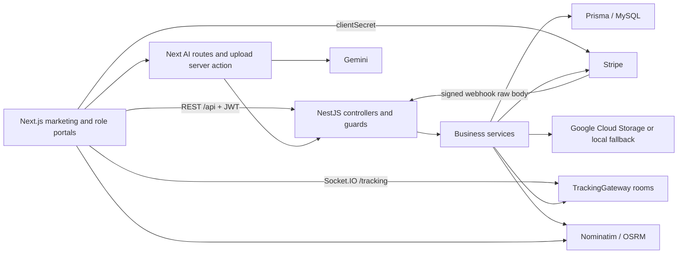

# FULL SYSTEM FORENSIC AUDIT

Audit date: 2026-11-06. Scope: `nglobi` and `backend_alexis` as one application. Audit-only; no application fixes, deployments, database operations, migrations or live payments were performed. Existing graphs and uncommitted application changes were preserved. New evidence was written only under this audit directory.

## Executive summary and release decision

**Do not approve this source snapshot for production deployment.** Public registration accepts privileged roles, public sockets permit unauthorized location operations, customers can mark invoices paid without payment, and tracked files contain credentials. Financial retry and concurrency defects can overcharge customers, lose receivables and leave paid jobs unfulfilled. Every role dashboard has confirmed defects affecting access, accuracy, updates or actions.

76 findings: 71 Confirmed, 3 Suspected, 2 Requires Runtime Verification. Severity: 4 Critical, 37 High, 35 Medium.

“Confirmed” means the defect is established in current source and, where stated, isolated mocked execution. It does not mean production exploitation or actual loss was observed. “Suspected” identifies a plausible issue needing additional evidence. “Requires Runtime Verification” covers environment-dependent behavior. The dependency finding counts once; npm's affected-package counts are not added as separate proven application exploits.

This is an extensive source and contract audit, not a claim of exhaustive runtime or formal verification. All 112 decorated backend routes and 164 literal frontend API call sites were inventoried; dynamic selectors, browser rendering, external services and deployment state have the specific gaps listed below. One frontend investigation ended before writing its narrative; its saved inventory and reported leads were retained and the listed frontend findings were verified by the primary investigator.

## Architecture and integration map

`nglobi/next.config.mjs:23-28` exposes API_URL at build time; most callers append `/auth`, `/bookings`, etc. Nest prefixes routes `/api` (`backend_alexis/src/main.ts:68`). Socket clients strip `/api` and use `/tracking`. Next afterFiles rewrites can proxy `/api`, while local AI handlers take precedence. CORS allows explicit portal domains. Correct origins, API prefix, build-time configuration and WebSocket proxy support must all agree.

`nglobi/proxy.ts` maps app/driver/manager/admin subdomains into app folders. Browser auth stores tokens in localStorage and shared readable cookies (`lib/auth-token.ts:69-81`); backend additionally sets HttpOnly cookies. HTTP JWT strategy resolves current user/role from DB, while sockets trust raw JWT claims. Layout role checks are UX controls; backend guards remain the authority. Manager permissions are globally scoped by current design; this audit does not assume tenant isolation without a business requirement.

Bookings move from PENDING through confirmation/assignment, ARRIVED, PACKED, LOADED, IN_TRANSIT, UNLOADING and DELIVERED, with cancellation/unreachable branches. Payment state is derived separately from Payment rows. Quotes store serialized drafts. Driver status transitions trigger invoices, debt and reward updates. Storage/StorageItem/StorageDelivery link inventory and return requests; invoices, promotions, bonuses and withdrawal records form additional financial paths. The findings show where these paths fail to remain consistent.

Prisma schema contains user/session, driver/application/documents/availability, booking/items/crew/materials, storage/items/delivery, payment, invoice, promotion/redemption, bonus/withdrawal, audit, notification and draft entities. Relations and foreign keys prevent some nonexistent references but do not enforce ownership, economic invariants or concurrent schedule exclusivity. Money predominantly uses Float. No checked-in Prisma migrations directory was found; deployed schema, backups and actual isolation were not inspected.

External dependencies include Stripe, GCS, Gemini, Google/Facebook/Apple OAuth, Nominatim/OSRM and browser map assets. Deployment artifacts target Docker/Cloud Run-style operation, Azure and Vercel; active production provider/topology was not established. The Azure workflow deploys main without behavioral tests. In-memory auth and socket state is particularly relevant to replicas/restarts.

Existing Graphify graphs (frontend, backend and merged graph) were queried for navigation. The merged graph contains 2,862 nodes and 5,607 edges from the earlier run. No graphs were rebuilt or modified during this audit. Stale graph/doc claims were checked against actual source; for example isExtraTime is present in the current payment DTO.

## Role dashboard audit

| Role/view | Inspected behavior and controls | Confirmed failures | Runtime sign-off |
|---|---|---|---|
| CUSTOMER | dashboard, orders, tracking, account/profile, quotes, approvals, storage, rewards; owner checks on primary REST reads | F01-F03, F07, F10; FIN-02/03/04 payment amounts; S24 notifications | Not approved |
| BUSINESS | customer portal plus invoice routes and Net 30 booking path; invoice routes restrict BUSINESS | FIN-01 fake settlement, FIN-20 partial invoice state; same customer issues | Not approved |
| DRIVER | role and approval layout; assignments, status transitions, history, availability, location, documents | S03 lost assignment events; S10-S13 financial/proof/race defects; S15-S18 document failures; F07 | Not approved |
| MANAGER | current HTTP role checks, application status, dispatch/assignment, live rides, fleet/documents, prices, invoices | S08-S09 assignment conflicts; F09 hidden failed actions; F10 live status corruption; F11 user data exposure; S26 unbounded lists | Not approved |
| ADMIN | ADMIN guard, dashboard stats, bookings, driver/manager administration, prices | S01 privilege escalation; S06 defaults; S07 unsafe assignment; S25 exposure; S28 inflated metrics; F04 pricing save | Not approved |
| AFFILIATE / partner | bonuses, referrals, withdrawal history/create, profile settings, sign-out | S14 concurrent overspend; FIN-18/25 reward policy; F08 incomplete sign-out; F09 hidden settings errors | Not approved |

Successful source checks worth preserving: ordinary JWT HTTP authorization reads the current DB role; notification REST mutations scope by user; primary booking/payment reads check ownership; manager pricing subpage builds a DTO allowlist; frontend cache keys include bearer identity and have a 100-entry bound. These checks do not negate the finding-specific failures.

## Verification performed and limitations

- Both repositories passed `tsc --noEmit --incremental false --pretty false`; disabling incremental avoided writing tsbuildinfo.
- Read-only ESLint without --fix: backend 83 files, 235 errors (234 formatting, one ban-ts-comment); frontend 188 files, 12 errors and 97 warnings (8 refs errors, 4 missing keys, hook/image warnings). Machine-readable outputs are preserved. Lint counts are not equated with distinct business defects.
- Isolated actual DTO probes: ADMIN registration had zero validation errors; all three displayed storage-return slots failed enum validation; pricing response metadata id failed update DTO validation.
- Isolated service/gateway probes with mocked dependencies: anonymous booking room join and GPS persistence reached handlers; duplicate same-second refresh JWTs matched; £200 minus £40 balance intent still charged £200; missing deposit snapshot charged £200; extra-time reused a principal intent; webhook retry skipped failed side effects; invalid FULL_HOUSE items bypassed validation.
- npm audit succeeded against the public registry after sandbox DNS failure; package metadata was submitted, not credentials. Full raw reports preserved. No npm install/update/audit fix was run.
- No application bootstrap/e2e invocation: existing e2e imports AppModule, which connects Prisma and schedules jobs. Root scratch/test scripts include live database/payment/service probes and were not run. No safe provisioned isolated database or complete fixture suite was available.
- Full Next/Nest build was not run: default scripts generate/overwrite .next, dist and Prisma client artifacts and can evaluate configured external integrations. Type checks and read-only lint provided safe compile/static checks.
- Production credential validity, Git history exposure extent, IAM, deployed env values, API reachability, Stripe reconciliation, cookie behavior in browser, OAuth provider configuration, cross-instance sockets, actual query plans/load, backups/restore and database concurrency were not exercised.
- Frontend API and key action paths were inspected; not every visual component, responsive state, accessibility behavior, dynamic route selector or marketing page was manually exercised. A browser acceptance matrix with controlled role accounts is still required. No claim that every screen is good is supported.

## Prioritized remediation and acceptance plan (no fixes executed)

1. Contain public privilege escalation, socket writes/reads, credential exposure and fake invoice settlement. Review access and payment records under an authorized incident process; rotate exposed credentials in a coordinated manner.
2. Correct payment purposes, amounts, deposit snapshots and idempotency; make webhook/refund processing recoverable. Reconcile existing processor and local ledgers before trusting dashboard balances.
3. Enforce transactional wallet/reward/schedule/state invariants, ownership of storage items and validated financial extras. Make private documents durable and access controlled.
4. Align all role dashboard contracts, authentication refresh/logout, proof uploads, notification subscriptions, pricing forms, storage slots and error states. Define cash/revenue/today metrics explicitly.
5. Upgrade verified affected runtime dependency chains, isolate test infrastructure, add regression cases listed for every finding, and gate deployments on those checks.
6. Run sandbox browser journeys for all six role views, database failure/race suites, Stripe test-mode event replay/refunds, two-instance sockets, load tests and restore exercise. Release only when critical/high findings are closed and remaining risks explicitly accepted.

## Severity-ranked findings index

| ID | Severity | Confidence | Finding |
|---|---|---|---|
| FIN-01 | Critical | Confirmed | Customer can mark an invoice paid without paying |
| O01 | Critical | Confirmed | Secrets and bearer tokens are committed in both repositories |
| S01 | Critical | Confirmed | Public registration can create ADMIN and MANAGER accounts |
| S02 | Critical | Confirmed | Unauthenticated sockets can watch bookings and forge driver GPS |
| F01 | High | Confirmed | Saved quote reads and deletes target nonexistent routes |
| F02 | High | Confirmed | Customer approvals cannot load pending items |
| F03 | High | Confirmed | Every customer storage return slot is rejected |
| F05 | High | Confirmed | Marketing booking links are redirected back to the homepage |
| FIN-02 | High | Confirmed | Balance payment charges total again after deposit |
| FIN-03 | High | Confirmed | Advertised deposit is charged as full total |
| FIN-04 | High | Confirmed | Extra time and principal intents collide; paid principal blocks extra-time settlement |
| FIN-05 | High | Confirmed | Concurrent intent creation has no effective idempotency |
| FIN-06 | High | Confirmed | Webhook commits payment success before fulfillment and skips failed work on retry |
| FIN-07 | High | Confirmed | Failed then successful payment remains locally FAILED |
| FIN-08 | High | Confirmed | Cancellation can leave a paid charge with a cancelled job |
| FIN-09 | High | Confirmed | Refund failures are swallowed after irreversible cancellation state |
| FIN-10 | High | Confirmed | Customer cancellation has no financial settlement; reschedule fees are only returned |
| FIN-11 | High | Confirmed | Address and inventory edits bypass repricing |
| FIN-12 | High | Confirmed | Client coordinates control authoritative route price |
| FIN-13 | High | Confirmed | FULL_HOUSE bypasses all item validation |
| FIN-14 | High | Confirmed | Storage delivery can reference another customer’s goods |
| FIN-15 | High | Confirmed | Storage deliveries are scheduled before collecting their charge |
| FIN-17 | High | Confirmed | Promo limits can be exceeded by multiple unpaid bookings |
| FIN-18 | High | Confirmed | Referral reward can be replayed through paid then cancelled first bookings |
| O02 | High | Confirmed | Public AI endpoints lack application quotas and payload bounds |
| O05 | High | Confirmed | Deployment pipeline has no behavioral test gate |
| O07 | High | Confirmed | Installed dependencies have published security advisories |
| S03 | High | Confirmed | Driver socket subscription reads the wrong JWT identity field |
| S04 | High | Confirmed | Logout/password reset do not revoke seven-day access tokens |
| S05 | High | Confirmed | Manager socket permissions survive demotion and token expiry |
| S06 | High | Confirmed | Default manager password is shared and predictable |
| S07 | High | Confirmed | Admin assignment bypasses booking payment, state and driver checks |
| S08 | High | Confirmed | Assignment checks race with cancellation and other assignments |
| S10 | High | Confirmed | Delivered state commits before rewards, debt and invoice transaction |
| S11 | High | Confirmed | Driver status endpoint bypasses DTO and accepts arbitrary financial extras |
| S13 | High | Confirmed | Driver undo can overwrite a concurrently completed booking |
| S14 | High | Confirmed | Withdrawal requests can overdraw the wallet concurrently |
| S17 | High | Confirmed | Public upload/download exposes private driver documents and accepts arbitrary content |
| S18 | High | Confirmed | GCS failure silently saves documents to ephemeral local disk |
| S19 | High | Confirmed | Password reset never sends email and logs the reset credential |
| S21 | High | Confirmed | Refresh tokens collide within a second and rotation may reissue the same token |
| F04 | Medium | Confirmed | Admin pricing editor submits forbidden response fields |
| F06 | Medium | Confirmed | Forgot-password route is redirected into login |
| F07 | Medium | Confirmed | Refresh helper is unused by dashboard API callers |
| F08 | Medium | Confirmed | Affiliate sign-out leaves shared cookies and server session active |
| F09 | Medium | Confirmed | Staff actions and affiliate settings hide HTTP failures |
| F10 | Medium | Confirmed | Extra-time debt display and live status models disagree |
| F11 | Medium | Confirmed | Invoice list sends full customer account records to manager browsers |
| FIN-16 | Medium | Confirmed | Concurrent first storage deliveries both become free |
| FIN-19 | Medium | Confirmed | Customer booking updates race fulfillment and retain conflicting assignment |
| FIN-20 | Medium | Confirmed | Booking plus linked storage and invoice state are not atomic |
| FIN-21 | Medium | Confirmed | Pricing preview does not apply authenticated promo eligibility |
| FIN-22 | Medium | Confirmed | Storage duration price differs between quote and booking |
| FIN-23 | Medium | Confirmed | Date and integer validation does not match database/business constraints |
| FIN-24 | Medium | Confirmed | Saved quote expiry is stored but not enforced |
| FIN-25 | Medium | Confirmed | Referral dashboard tiers disagree with paid reward policy |
| FIN-26 | Medium | Suspected | Storage subscription renewal and inventory ingestion are absent from runtime source |
| FIN-27 | Medium | Suspected | Monetary ledger persists binary floats |
| FIN-28 | Medium | Requires Runtime Verification | External route services are sequential dependencies for checkout |
| O03 | Medium | Confirmed | API readiness and pricing obscure database failures |
| O04 | Medium | Confirmed | Photo identification route buffers unrestricted uploads and returns mock results |
| O06 | Medium | Requires Runtime Verification | Socket rooms and broadcasts are local to each process |
| S09 | Medium | Confirmed | Driver availability and actual exact pickup time are not enforced by assignment |
| S12 | Medium | Confirmed | Delivery proof photo is discarded by the controller |
| S15 | Medium | Confirmed | Driver onboarding/approval is non-atomic and inconsistent across roles |
| S16 | Medium | Confirmed | Approved drivers can replace reviewed documents without reapproval |
| S20 | Medium | Confirmed | OAuth codes and password resets are stored only in process memory |
| S22 | Medium | Confirmed | Cookie authentication fallback is not wired into Express |
| S23 | Medium | Confirmed | Apple callback path differs from registered controller path |
| S24 | Medium | Confirmed | Personal notification socket rooms are never joined |
| S25 | Medium | Confirmed | Admin booking responses disclose password hashes |
| S26 | Medium | Confirmed | Operational lists load all bookings, documents and large proof blobs |
| S27 | Medium | Confirmed | Fleet recommendation claims random proximity and understates oversized vehicles |
| S28 | Medium | Confirmed | Admin revenue includes unpaid and cancelled carts |
| S29 | Medium | Suspected | OAuth identity linking by email permits pre-account takeover and missing state binding |
| S30 | Medium | Confirmed | Audit persistence failures are swallowed and privileged account actions lack audit trails |

## Detailed evidence, consequences and regression tests

All unprefixed src/ and prisma/ paths in FIN/S evidence refer to backend_alexis; nglobi paths are explicitly prefixed. Lines identify the audited workspace snapshot.

## FIN-01: Customer can mark an invoice paid without paying

- Severity: **Critical**. Confidence: **Confirmed**.
- Evidence: `backend_alexis/src/invoices/invoices.controller.ts:18-23; src/invoices/invoices.service.ts:28-40` (paths beginning `nglobi/` are in the frontend repository).
- Root cause: The BUSINESS customer route directly sets InvoiceStatus.PAID after ownership lookup; no processor, ledger, or settlement verification occurs.
- Trigger: A business user calls POST /invoices/:id/pay on their unpaid invoice.
- Business consequence: Receivables disappear without collecting money and fulfillment may proceed against false paid records.
- Recommended solution: Replace customer status mutation with a processor checkout; settle from verified payment events. Keep separately authorized offline settlement with evidence and actor audit.
- Regression test: Customer pay request must not mark PAID until a matching successful payment is verified.

## O01: Secrets and bearer tokens are committed in both repositories

- Severity: Critical
- Confidence: Confirmed
- Evidence: backend_alexis/envtxt:1-17; backend_alexis/env copy:1-7; backend_alexis/.env.azure:1; backend_alexis/token.txt:1; backend_alexis/token2.txt:1; nglobi/envtxt:1-20
- Root cause / relevant code: git ls-files confirms credential-bearing environment copies and JWT-shaped token files are tracked. Values deliberately omitted.
- Trigger and business consequence: Repository/CI artifact readers may obtain credentials. Current validity and past unauthorized use were not tested. Exposure can compromise databases, accounts and service spending.
- Recommended solution: Coordinate rotation/revocation, history cleanup, secret manager migration and preventive scanning. Do not rely on deletion or gitignore alone.
- Regression test: Secret scanner rejects representative token/env fixtures and verifies no real secrets in tracked artifacts/history selected for distribution.

## S01: Public registration can create ADMIN and MANAGER accounts

- Severity: Critical
- Confidence: Confirmed
- Evidence: backend_alexis/src/auth/dto/auth.dto.ts:34-41; src/auth/auth.service.ts:62-70; src/auth/auth.controller.ts:94-102
- Root cause / relevant code: The role property has only @IsString; its TypeScript union and Swagger enum do not constrain runtime values. register writes Role[dto.role].
- Trigger: Submit a normal registration body with role ADMIN. An isolated validation probe returned zero errors and Role.ADMIN. No production request was made.
- Business consequence: Unauthenticated self-elevation grants administrative access to customer records, pricing, assignments and account management.
- Recommended solution: Enforce a server-owned public role allowlist with @IsIn and a service-level guard; keep privileged account creation separate.
- Regression test: Register every privileged enum value and unknown strings; expect rejection and no user/token creation.

## S02: Unauthenticated sockets can watch bookings and forge driver GPS

- Severity: Critical
- Confidence: Confirmed
- Evidence: backend_alexis/src/tracking/tracking.gateway.ts:47-74,122-168
- Root cause / relevant code: Missing/invalid JWTs remain connected. subscribe-booking joins without ownership checks; update-location accepts driverId and bookingId without principal or assignment checks.
- Trigger: Join another booking room or send coordinates with known identifiers. Isolated actual-handler probes joined one room and performed one mocked DB update without credentials.
- Business consequence: Location privacy loss, forged dispatch/customer tracking, operational disruption and unauthenticated DB write amplification.
- Recommended solution: Reject unauthenticated connections; authorize each room and write; derive driver identity from verified user; enforce assignment and quotas.
- Regression test: Missing/invalid JWT disconnects; unrelated customer cannot join; driver cannot update another driver or booking; valid assigned driver succeeds.

## F01: Saved quote reads and deletes target nonexistent routes

- Severity: High
- Confidence: Confirmed
- Evidence: nglobi/app/app/my-quotes/page.tsx:29,49,67; backend_alexis/src/quotes/quote.controller.ts:38-49
- Root cause / relevant code: Frontend uses singular /quotes/draft for GET/DELETE; backend defines plural /quotes/drafts.
- Trigger and business consequence: Open, resume or delete a saved quote: requests fail and the page can appear empty. Lost conversion and work.
- Recommended solution: Align paths and handle non-OK responses visibly.
- Regression test: Exercise save, list, resume and delete through real HTTP route mapping.

## F02: Customer approvals cannot load pending items

- Severity: High
- Confidence: Confirmed
- Evidence: nglobi/app/app/approvals/page.tsx:37-49; backend_alexis/src/bookings/bookings.controller.ts:49-59; backend_alexis/src/approval/approval.controller.ts:29-45
- Root cause / relevant code: /bookings/my-bookings and /approval/bookings/:id/pending-items do not exist. GET /bookings returns grouped active/previous, not the array the page assumes.
- Trigger and business consequence: Open approvals: failed first request leaves empty state, preventing customer consent and disrupting jobs.
- Recommended solution: Consume /approval/pending and map its items into the view model; distinguish error from empty.
- Regression test: Seed pending items, load page, approve/reject and verify server and driver state.

## F03: Every customer storage return slot is rejected

- Severity: High
- Confidence: Confirmed
- Evidence: nglobi/app/app/dashboard/storage/page.tsx:52,131-142,384-386; backend_alexis/src/storage/dto/storage.dto.ts:23-30
- Root cause / relevant code: ALL_DAY/MORNING/AFTERNOON are not members of Prisma TimeSlot. Actual DTO probes rejected all three.
- Trigger and business consequence: Any return request from this screen receives 400; customers cannot retrieve stored goods through the UI.
- Recommended solution: Share backend slot enum or explicit supported mapping.
- Regression test: Submit each displayed option and assert accepted, correctly scheduled delivery.

## F05: Marketing booking links are redirected back to the homepage

- Severity: High
- Confidence: Confirmed
- Evidence: nglobi/app/services/student-moving/page.tsx:36; nglobi/proxy.ts:64-84
- Root cause / relevant code: A relative /app/book link on the main domain hits a rule redirecting /app paths to /.
- Trigger and business consequence: Prospect clicks quote on the main domain and returns home instead of booking; lost leads.
- Recommended solution: Use canonical portal URLs or route main-domain /app links to the corresponding portal while preserving path/query.
- Regression test: Test each public quote/account CTA on www and all configured portal domains.

## FIN-02: Balance payment charges total again after deposit

- Severity: **High**. Confidence: **Confirmed**.
- Evidence: `backend_alexis/src/payments/payments.service.ts:58-93; src/payments/payment-state.util.ts:35-42` (paths beginning `nglobi/` are in the frontend repository).
- Root cause: Payment state computes amountDue but createIntent only uses the state; amount is booking.totalPrice.
- Trigger: For a £200 booking with £40 SUCCEEDED deposit, request a non-deposit intent. An isolated mock probe produced 20000 pence instead of 16000.
- Business consequence: Overcharging, disputes, refunds, and customer distrust.
- Recommended solution: Derive chargeable remaining principal from successful principal payments and reserve that amount atomically.
- Regression test: £200 booking minus £40 paid must produce exactly £160; repeated requests must reuse one purpose/amount intent.

## FIN-03: Advertised deposit is charged as full total

- Severity: **High**. Confidence: **Confirmed**.
- Evidence: `backend_alexis/src/bookings/bookings.service.ts:166-169; src/payments/payments.service.ts:89-93; nglobi/app/app/page.tsx:2649-2699; nglobi/app/app/book/page.tsx:1126-1169; nglobi/components/nglob-missing-1-5.tsx:214-216` (paths beginning `nglobi/` are in the frontend repository).
- Root cause: Frontend creation omits payDeposit, so depositAmount is null. Payment isDeposit then falls back to the full total while checkout displays £40.
- Trigger: Select deposit on a newly created booking. Mock service probe for null depositAmount charged 20000 pence on £200.
- Business consequence: Customer pays much more than displayed and deposit/balance bookkeeping is missing.
- Recommended solution: Establish deposit plan server-side from payment purpose; use configured deposit capped at order total and return exact payable amount to UI.
- Regression test: Fresh deposit journey must show and charge the same configured amount and persist remainder.

## FIN-04: Extra time and principal intents collide; paid principal blocks extra-time settlement

- Severity: **High**. Confidence: **Confirmed**.
- Evidence: `backend_alexis/src/payments/payments.service.ts:58-85,89-99` (paths beginning `nglobi/` are in the frontend repository).
- Root cause: Pending lookup matches isDeposit but ignores isExtraTime and amount. PAID principal rejects before inspecting extra-time purpose.
- Trigger: Request extra time while a normal non-deposit intent is pending, or after principal is paid. Mock returned the existing principal client secret for extra time.
- Business consequence: Wrong charge purpose/amount; legitimate extra-time debt cannot be collected after full payment.
- Recommended solution: Separate principal/deposit/extra-time purposes; validate debt status and amount independently.
- Regression test: Paid principal plus £20 extra-time debt must allow exactly £20; normal intent cannot be reused for extra time.

## FIN-05: Concurrent intent creation has no effective idempotency

- Severity: **High**. Confidence: **Confirmed**.
- Evidence: `backend_alexis/src/payments/payments.service.ts:49-138; prisma/schema.prisma:319-339` (paths beginning `nglobi/` are in the frontend repository).
- Root cause: Read pending payment, create Stripe intent, then insert DB row are separate operations; no Stripe idempotency key or unique active purpose constraint.
- Trigger: Two requests read no pending intent before either inserts; both obtain distinct payable intents. A DB insert failure also leaves an orphan external intent.
- Business consequence: Duplicate charges and unreconciled processor objects.
- Recommended solution: Use stable Stripe idempotency keys and a database reservation keyed by booking/purpose/version; reconcile orphan outcomes.
- Regression test: Race two calls behind a barrier and assert one external intent and one active reservation.

## FIN-06: Webhook commits payment success before fulfillment and skips failed work on retry

- Severity: **High**. Confidence: **Confirmed**.
- Evidence: `backend_alexis/src/payments/payments.service.ts:265-307; src/bookings/bookings.service.ts:642-688` (paths beginning `nglobi/` are in the frontend repository).
- Root cause: Payment SUCCEEDED is persisted before booking, reward, and storage effects. A retry sees SUCCEEDED and returns; booking confirmation similarly returns once status moved.
- Trigger: Inject a DB/service failure after payment update. Mock retry made only one confirmation attempt and left state SUCCEEDED.
- Business consequence: Paid customers can remain unconfirmed or lose rewards; payment retries do not repair partial state.
- Recommended solution: Transactional ledger and state updates plus durable outbox with independently idempotent side effects.
- Regression test: Inject failure at every post-payment boundary and replay webhook; all required effects eventually occur once.

## FIN-07: Failed then successful payment remains locally FAILED

- Severity: **High**. Confidence: **Confirmed**.
- Evidence: `backend_alexis/src/payments/payments.service.ts:250-259,265-298` (paths beginning `nglobi/` are in the frontend repository).
- Root cause: Failure handler changes PENDING to FAILED, but success handler only promotes PENDING and ignores update count before confirming booking.
- Trigger: The same intent fails a card attempt and later succeeds on retry.
- Business consequence: Processor collected funds while dashboards say unpaid; duplicate payment prompts and bad accounting.
- Recommended solution: Allow a verified success to advance eligible failed attempts, reconcile event ordering, and check mutation result.
- Regression test: Deliver failed then succeeded events for the same intent and assert SUCCEEDED ledger and correct amountDue.

## FIN-08: Cancellation can leave a paid charge with a cancelled job

- Severity: **High**. Confidence: **Confirmed**.
- Evidence: `backend_alexis/src/payments/payments.service.ts:49-65,120-125; src/bookings/booking-expiry.service.ts:24-38; src/bookings/bookings.service.ts:642-646` (paths beginning `nglobi/` are in the frontend repository).
- Root cause: Intent creation does not restrict cancelled booking status; expiry does not cancel pending Stripe intents. Confirmation updates only PENDING bookings.
- Trigger: Customer completes a pending intent after two-hour expiry or cancellation, or creates an intent for a cancelled booking.
- Business consequence: Money collected with no fulfillment and no automatic refund path for that outcome.
- Recommended solution: Invalidate or cancel processor intents on cancellation; reconcile late success and refund or route to explicit review.
- Regression test: Cancel/expire while checkout is open, then deliver success; verify controlled outcome and no stranded money.

## FIN-09: Refund failures are swallowed after irreversible cancellation state

- Severity: **High**. Confidence: **Confirmed**.
- Evidence: `backend_alexis/src/payments/payments.service.ts:178-195; src/manager/manager.service.ts:161-174` (paths beginning `nglobi/` are in the frontend repository).
- Root cause: Refund errors only log, manager cancellation succeeds and tells customer payment will be refunded. A successful processor refund followed by failed DB update also leaves SUCCEEDED locally.
- Trigger: Processor outage or DB failure during refund; retry cancellation is rejected by state machine.
- Business consequence: Unreturned funds, chargebacks, ledger discrepancies, manual support workload.
- Recommended solution: Persist refund requests and states with idempotency and retry worker; return truthful pending status; reconcile processor events.
- Regression test: Inject refund failure and post-refund DB failure; retries eventually produce one refund and matching ledger.

## FIN-10: Customer cancellation has no financial settlement; reschedule fees are only returned

- Severity: **High**. Confidence: **Confirmed**.
- Evidence: `backend_alexis/src/bookings/bookings.service.ts:410-457,461-496` (paths beginning `nglobi/` are in the frontend repository).
- Root cause: Cancellation computes fee but only sets status; no refund or fee payment. Reschedule fee is computed and audited but not added to payable balance.
- Trigger: Cancel a prepaid job or repeatedly reschedule within the fee window.
- Business consequence: Unsettled refunds and lost rescheduling revenue; discrepancy between quoted terms and collected charges.
- Recommended solution: Implement explicit cancellation/refund policy and fee ledger, with idempotent settlement rather than return-only numbers.
- Regression test: Prepaid cancellation reconciles retained fee/refund; close-date reschedule adds one correct fee.

## FIN-11: Address and inventory edits bypass repricing

- Severity: **High**. Confidence: **Confirmed**.
- Evidence: `backend_alexis/src/bookings/bookings.service.ts:500-605` (paths beginning `nglobi/` are in the frontend repository).
- Root cause: Edit endpoints change addresses/items and optionally add a fixed fee without recalculating route, volume, duration, staffing, or base price.
- Trigger: Book a cheap short move then change to a distant destination or much larger inventory before fulfillment.
- Business consequence: Systematic undercharging and impossible fleet schedules.
- Recommended solution: Recompute quote from authoritative data, expire prior payment intents, update capacity allocation and collect delta with customer approval.
- Regression test: Changing 1 km to 100 km or increasing inventory must change pricing/duration and invalidate stale intent.

## FIN-12: Client coordinates control authoritative route price

- Severity: **High**. Confidence: **Confirmed**.
- Evidence: `backend_alexis/src/pricing/pricing.service.ts:378-408; src/bookings/bookings.service.ts:89-95; src/bookings/dto/create-booking.dto.ts:83-86` (paths beginning `nglobi/` are in the frontend repository).
- Root cause: Truthy supplied coordinates are trusted instead of deriving or checking them against addresses.
- Trigger: Submit distant addresses with nearby coordinates, which OSRM routes as a short job.
- Business consequence: Underpriced fuel/time and incorrect pickup tracking.
- Recommended solution: Resolve authoritative coordinates server-side or verify signed server-issued geocode/quote data.
- Regression test: Tampered coordinates inconsistent with addresses must be rejected or ignored.

## FIN-13: FULL_HOUSE bypasses all item validation

- Severity: **High**. Confidence: **Confirmed**.
- Evidence: `backend_alexis/src/bookings/dto/create-booking.dto.ts:114-120; src/bookings/bookings.service.ts:99-102,236-248; src/pricing/pricing.service.ts:441-449` (paths beginning `nglobi/` are in the frontend repository).
- Root cause: ValidateIf disables array and nested validation for FULL_HOUSE, but service always maps items and pricing uses any nonempty items ahead of home size.
- Trigger: Omit items to trigger TypeError, or send a minimal/invalid item list with FULL_HOUSE to override loading time. Mock validator accepted negative item dimensions without errors.
- Business consequence: Checkout 500s, corrupt inventory, and lower loading charges for full-house jobs.
- Recommended solution: Always validate supplied arrays; require consistent type-specific fields and choose pricing mode explicitly from booking type.
- Regression test: FULL_HOUSE omitted/invalid items handled safely; tiny supplied item cannot override full-house loading floor.

## FIN-14: Storage delivery can reference another customer’s goods

- Severity: **High**. Confidence: **Confirmed**.
- Evidence: `backend_alexis/src/storage/storage.service.ts:77-105; prisma/schema.prisma:307-315` (paths beginning `nglobi/` are in the frontend repository).
- Root cause: Ownership checks apply to the storage record but each supplied storageItemId is inserted without checking it belongs to that storage. Foreign key only proves existence.
- Trigger: Owner of storage A supplies a known item ID from storage B.
- Business consequence: Cross-customer delivery records and potential release of another customer’s goods if operations trust these records.
- Recommended solution: Fetch all requested items with storageId=current storage and reject any mismatch before transaction.
- Regression test: Foreign item ID must return forbidden/not found and create no delivery.

## FIN-15: Storage deliveries are scheduled before collecting their charge

- Severity: **High**. Confidence: **Confirmed**.
- Evidence: `backend_alexis/src/storage/storage.service.ts:85-109; prisma/schema.prisma:289-302; src/payments/payments.service.ts:302-306` (paths beginning `nglobi/` are in the frontend repository).
- Root cause: Delivery creation defaults status SCHEDULED even when cost=25; payment success merely writes the same state.
- Trigger: Create a second delivery and abandon checkout.
- Business consequence: Operations may fulfill a chargeable delivery without payment.
- Recommended solution: Introduce awaiting-payment state and only schedule after verified settlement; explicitly handle free entitlement.
- Regression test: Unpaid £25 delivery must be excluded from dispatch and only become scheduled after payment.

## FIN-17: Promo limits can be exceeded by multiple unpaid bookings

- Severity: **High**. Confidence: **Confirmed**.
- Evidence: `backend_alexis/src/promo/promo.service.ts:63-78,105-117; src/bookings/bookings.service.ts:134-156,685-688; prisma/schema.prisma:384-397` (paths beginning `nglobi/` are in the frontend repository).
- Root cause: Promo eligibility is checked at booking creation but usage is recorded only after payment; uses/count writes are not transactional and have no per-user uniqueness.
- Trigger: Create multiple discounted pending bookings before paying any, then pay all. Also concurrent users can exceed maxUses.
- Business consequence: Unbounded discounts beyond intended campaign limits; corrupted counters after partial write.
- Recommended solution: Reserve redemption atomically with uniqueness and expiry; enforce campaign cap and per-user policy on settlement.
- Regression test: Multiple pending bookings and concurrent last-use requests cannot exceed entitlement; retry does not increment twice.

## FIN-18: Referral reward can be replayed through paid then cancelled first bookings

- Severity: **High**. Confidence: **Confirmed**.
- Evidence: `backend_alexis/src/bookings/bookings.service.ts:650-669; src/manager/manager.service.ts:161-174; src/payments/payments.service.ts:178-195` (paths beginning `nglobi/` are in the frontend repository).
- Root cause: First-order eligibility ignores CANCELLED bookings and no immutable rewarded-customer constraint or reward reversal exists.
- Trigger: Pay first referred booking, cancel/refund, then pay another. No previous non-pending/non-cancelled booking remains, so referrer is credited again.
- Business consequence: Referral wallet farming and payout losses, especially with coordinated accounts.
- Recommended solution: Unique reward per referred customer tied to settled non-refunded outcome; reversal ledger on refund and abuse controls.
- Regression test: Paid→refunded→new booking cannot mint another first-customer reward; wallet reconciles refund policy.

## O02: Public AI endpoints lack application quotas and payload bounds

- Severity: High
- Confidence: Confirmed
- Evidence: nglobi/app/api/ai-assistant/route.ts:65-116; nglobi/app/api/ai-vision/detect/route.ts:73-133; nglobi/proxy.ts:205-216
- Root cause / relevant code: Public Next API routes accept caller-controlled history/base64 and call paid Gemini APIs without auth/quota, application body size bounds or outbound deadline; API routes bypass proxy.
- Trigger and business consequence: Repeated large requests consume model spend and request memory; slow upstream retains requests. Upstream hosting limits may reduce exposure but are not shown.
- Recommended solution: Enforce input size/schema, per-user/IP quotas and spend limits, timeouts and bounded concurrency.
- Regression test: Oversized requests rejected before upstream call; rate limits hold across instances; timeout returns controlled error.

## O05: Deployment pipeline has no behavioral test gate

- Severity: High
- Confidence: Confirmed
- Evidence: backend_alexis/.github/workflows/azure-deploy.yml:3-6,31-62; backend_alexis/test/app.e2e-spec.ts:10-26; backend_alexis/package.json:9-23
- Root cause / relevant code: Push to main installs, builds and deploys without tests. Only conventional e2e spec boots real AppModule and expects scaffold Hello World; runtime src has no unit specs.
- Trigger and business consequence: Type-correct security/payment regressions deploy automatically. Running existing e2e can initialize real DB/schedulers, so it was deliberately not run.
- Recommended solution: Isolated test database and fake services; require authorization, payment, race and dashboard contract tests before deployment.
- Regression test: Fail a business invariant test and assert deployment job is blocked; verify test process cannot reach production endpoints.

## O07: Installed dependencies have published security advisories

- Severity: High
- Confidence: Confirmed
- Evidence: nglobi/package-lock.json (node_modules/next 16.2.4); backend_alexis/package-lock.json (nested platform-express multer 2.0.2, engine.io 6.6.6); audit npm JSON evidence and dependency table below
- Root cause / relevant code: Locked runtime packages fall within advisory ranges. npm audit reports 60 backend and 42 frontend affected package entries, including development/transitive entries, not 102 independently demonstrated exploits.
- Trigger and business consequence: Known framework/multipart/socket denial-of-service exposure needs remediation; other scanner critical findings have configuration-specific conditions not demonstrated here.
- Recommended solution: Upgrade affected dependency chains after compatibility review, rerun audit, then exercise app regression suite. Do not run automatic force upgrades without review.
- Regression test: Verify lockfile no longer includes affected versions and regress valid/rejected uploads, RSC requests and socket reconnects.

## S03: Driver socket subscription reads the wrong JWT identity field

- Severity: High
- Confidence: Confirmed
- Evidence: backend_alexis/src/auth/auth.service.ts:276-277; src/tracking/tracking.gateway.ts:68-69,97-105; nglobi/app/driver/page.tsx:205-211
- Root cause / relevant code: Tokens contain sub but raw decoded claims are stored as user; handler uses user.id in a unique Prisma lookup.
- Trigger: A correctly logged-in DRIVER subscribes. user.id is undefined, so lookup fails validation instead of joining the driver room.
- Business consequence: Assignment updates are silently missed; drivers can miss dispatched or changed jobs.
- Recommended solution: Normalize verified claims to a current database principal and use sub consistently.
- Regression test: Use a real locally signed token with sub and verify the driver's own room join and assignment event delivery.

## S04: Logout/password reset do not revoke seven-day access tokens

- Severity: High
- Confidence: Confirmed
- Evidence: backend_alexis/src/auth/auth.service.ts:208-220,268-286; src/auth/strategies/jwt.strategy.ts:32-40
- Root cause / relevant code: Logout/reset delete refresh rows only. Access tokens last seven days; JWT strategy checks user existence/current role but no session version or token revocation.
- Trigger: Reuse a stolen access token after logout or password reset while the account remains present.
- Business consequence: An attacker can retain access for up to seven days after a user attempts recovery.
- Recommended solution: Use short-lived access tokens and session version/revocation checks; invalidate all required sessions on reset.
- Regression test: Authenticate, logout/reset, replay prior access token; verify policy rejects it immediately or within documented short lifetime.

## S05: Manager socket permissions survive demotion and token expiry

- Severity: High
- Confidence: Confirmed
- Evidence: backend_alexis/src/tracking/tracking.gateway.ts:64-88; src/admin/admin.service.ts:253-274
- Root cause / relevant code: Socket authentication trusts the embedded role and checks expiry only at connection; no database role refresh or room eviction exists.
- Trigger: Demoted manager reconnects using a still-valid old JWT or keeps an existing socket open after expiry.
- Business consequence: Former staff continue receiving global dispatch and location events.
- Recommended solution: Fetch current role during authorization, bind rooms to session lifetime and evict on revocation/demotion.
- Regression test: Demote a connected manager and expire token; assert subsequent subscriptions and broadcasts are denied.

## S06: Default manager password is shared and predictable

- Severity: High
- Confidence: Confirmed
- Evidence: backend_alexis/src/admin/admin.service.ts:219-242; src/admin/dto/admin.dto.ts:22-32
- Root cause / relevant code: Omitting optional password creates a manager with a fixed literal password.
- Trigger: An administrator creates a manager without specifying a password.
- Business consequence: Anyone knowing the email and code default may access global manager data and operations.
- Recommended solution: Use expiring invitation links and user-chosen passwords; never a shared fallback.
- Regression test: Create manager without password; verify no predictable login credential exists and invitation flow is mandatory.

## S07: Admin assignment bypasses booking payment, state and driver checks

- Severity: High
- Confidence: Confirmed
- Evidence: backend_alexis/src/admin/admin.controller.ts:60-64; src/admin/admin.service.ts:79-84
- Root cause / relevant code: Separate admin service unconditionally sets driverId and SCHEDULED, unlike manager service validation.
- Trigger: Assign a driver to PENDING unpaid, CANCELLED or DELIVERED booking, or assign rejected/unavailable driver.
- Business consequence: Unpaid service dispatch, resurrection of cancelled/refunded jobs, invalid scheduling and duplicated work.
- Recommended solution: Share one validated assignment transaction across admin and manager routes with explicit audited override if required.
- Regression test: Exercise admin and manager endpoints against each status, payment state and driver approval condition; expect identical invariants.

## S08: Assignment checks race with cancellation and other assignments

- Severity: High
- Confidence: Confirmed
- Evidence: backend_alexis/src/manager/manager.service.ts:263-285,321-350
- Root cause / relevant code: Reads and overlap/status checks occur before an unconditional update by id; no locking or compare-and-swap protects the decision.
- Trigger: Two requests concurrently assign the same driver to full-house jobs, or assignment resumes after another request cancels the booking.
- Business consequence: Double booking or resurrected cancelled jobs produces missed moves, refunds and reputation damage.
- Recommended solution: Lock schedule resources or serialize assignment and compare booking status/version within a transaction.
- Regression test: Barrier-controlled concurrent assignment and cancellation tests must permit only a consistent final schedule/state.

## S10: Delivered state commits before rewards, debt and invoice transaction

- Severity: High
- Confidence: Confirmed
- Evidence: backend_alexis/src/driver/driver.service.ts:343-349,368-413
- Root cause / relevant code: Status optimistic update succeeds before downstream transaction. A failure there leaves DELIVERED and retries cannot repeat the transition.
- Trigger: Inject a DB failure while updating wallet, debt or invoice after status change.
- Business consequence: Completed jobs can lack receivables, invoices or bonuses; customer debt is permanently lost until manual repair.
- Recommended solution: Commit state and financial effects together or use durable idempotent outbox processing.
- Regression test: Fail each downstream step, retry same delivery operation, and assert exactly one complete state/ledger outcome.

## S11: Driver status endpoint bypasses DTO and accepts arbitrary financial extras

- Severity: High
- Confidence: Confirmed
- Evidence: backend_alexis/src/driver/driver.controller.ts:221-245; src/driver/driver.service.ts:322-341,378-400
- Root cause / relevant code: The route uses @Body() body:any, so DTO validation is bypassed. Extra item price, hours and packing costs have no nonnegative bounds; payment methods CARD/CASH are accepted as assertions.
- Trigger: Assigned driver sends negative hours/material prices or labels unpaid extra charges CARD, then advances an allowed status.
- Business consequence: Incorrect invoices and debt, suppressed receivables and unsupported payment records.
- Recommended solution: Use concrete validated DTOs, nonnegative bounded money/time fields, and server-verified payment state for CARD; audit cash collection.
- Regression test: Reject negative/NaN/oversized inputs and unverified card-paid assertions; allow valid approved charges only.

## S13: Driver undo can overwrite a concurrently completed booking

- Severity: High
- Confidence: Confirmed
- Evidence: backend_alexis/src/driver/driver.service.ts:520-539
- Root cause / relevant code: Undo reads current state then updates by id without state/version condition.
- Trigger: Undo reads UNLOADING; concurrent delivery commits DELIVERED and financial effects; undo overwrites to IN_TRANSIT.
- Business consequence: A later delivery can repeat bonuses/debt or invoice work, and delivered jobs reappear in operations.
- Recommended solution: Use conditional update matching previous state/version and transactionally manage transition side effects.
- Regression test: Synchronize undo and delivery at read/write barrier; only one transition should succeed and ledger effects remain exactly once.

## S14: Withdrawal requests can overdraw the wallet concurrently

- Severity: High
- Confidence: Confirmed
- Evidence: backend_alexis/src/users/users.service.ts:140-162; src/users/users.controller.ts:42-49
- Root cause / relevant code: Balance check precedes transaction; debit update is unconditional.
- Trigger: Two simultaneous withdrawals each pass the same balance check and both decrement.
- Business consequence: Negative balances and multiple payable withdrawal claims exceed legitimate earnings.
- Recommended solution: Use conditional wallet debit where balance>=amount inside transaction and validated integer minor units.
- Regression test: For balance 100 submit simultaneous withdrawals of 80; exactly one succeeds and balance remains 20.

## S17: Public upload/download exposes private driver documents and accepts arbitrary content

- Severity: High
- Confidence: Confirmed
- Evidence: backend_alexis/src/driver/driver.controller.ts:93-131,150-181; nglobi/app/driver/apply/documents/page.tsx:109-129
- Root cause / relevant code: No guard on upload or file retrieval; no content allowlist/signature verification; upload calls makePublic and read proxy streams GCS objects for any known name.
- Trigger: Upload a private licence through normal flow then fetch its URL anonymously; attackers can also upload arbitrary content up to per-file limit.
- Business consequence: Sensitive document exposure and storage/bandwidth abuse; public proxy bypasses bucket privacy for known names.
- Recommended solution: Separate private/public stores; authenticate upload/read with ownership; content validation and quotas; short-lived authorized URLs.
- Regression test: Anonymous private document read/upload denied; cross-user reads denied; disallowed formats rejected.

## S18: GCS failure silently saves documents to ephemeral local disk

- Severity: High
- Confidence: Confirmed
- Evidence: backend_alexis/src/driver/driver.controller.ts:132-145; src/main.ts:59-65; nglobi/app/actions/upload.ts:60-73
- Root cause / relevant code: Cloud write failures become success responses with local file URLs; durable DB document references outlive instance disk.
- Trigger: GCS outage/permission failure followed by restart or requests routed to a different container.
- Business consequence: Uploaded documents/photos become unavailable and may be unrecoverable; onboarding or disputes lose evidence.
- Recommended solution: Fail upload with retryable error unless durable storage succeeds; use durable queue if offline acceptance is needed.
- Regression test: Simulate GCS failure, restart/switch instance, and ensure no successful upload response references disposable data.

## S19: Password reset never sends email and logs the reset credential

- Severity: High
- Confidence: Confirmed
- Evidence: backend_alexis/src/auth/auth.service.ts:240-250
- Root cause / relevant code: Forgot-password creates URL and writes it to console instead of sending mail.
- Trigger: Customer requests recovery; API says success but customer receives no reset link. Log readers can obtain bearer reset links.
- Business consequence: Customers cannot recover accounts; support load and abandonment; logs become an account takeover surface.
- Recommended solution: Deliver a transactional reset email, redact bearer credentials from logs, and monitor delivery.
- Regression test: Request reset: assert mocked mail delivery receives link, ordinary logs contain no token, nonexistent user response remains indistinguishable.

## S21: Refresh tokens collide within a second and rotation may reissue the same token

- Severity: High
- Confidence: Confirmed
- Evidence: backend_alexis/src/auth/auth.service.ts:186-205,276-299; prisma/schema.prisma:46-48
- Root cause / relevant code: JWT payload lacks random jti; identical subject/email/role and second produce same JWT. Stored digest has unique constraint.
- Trigger: Two logins in same second conflict on refresh row; refresh in issuance second deletes then recreates the same token. Safe JwtService probe confirmed equality for same claims/iat.
- Business consequence: Intermittent login errors and ineffective single-use rotation, especially concurrent tabs/retries.
- Recommended solution: Random unique refresh tokens/jti, transactional rotation, replay detection and defined concurrent-tab policy.
- Regression test: Two same-second logins yield different refresh tokens; redeemed token never reappears; concurrent refresh produces controlled responses.

## F04: Admin pricing editor submits forbidden response fields

- Severity: Medium
- Confidence: Confirmed
- Evidence: nglobi/app/admin/prices/page.tsx:27-29,46-48; backend_alexis/src/pricing/dto/update-pricing.dto.ts:3-25; backend_alexis/src/pricing/pricing.service.ts:227-237; backend_alexis/src/main.ts:71-76
- Root cause / relevant code: The full GET object including id is submitted to a whitelist DTO with forbidNonWhitelisted. In-memory validation rejects id.
- Trigger and business consequence: Load normal database-backed settings and Save: request fails, blocking pricing changes.
- Recommended solution: Build a payload from writable DTO fields and display validation errors.
- Regression test: Load settings with id/metadata, edit rate, save and refetch the changed value.

## F06: Forgot-password route is redirected into login

- Severity: Medium
- Confidence: Confirmed
- Evidence: nglobi/proxy.ts:4,23-33; nglobi/app/(auth)/forgot-password/page.tsx:18
- Root cause / relevant code: Forgot-password is in AUTH_PAGE_ROUTES, and every non-register member selects login mode.
- Trigger and business consequence: Navigating to recovery never renders the recovery form. Combined with S19, recovery is broken at both layers.
- Recommended solution: Preserve recovery route or provide an explicit recovery modal state.
- Regression test: Navigate to /forgot-password from login and complete mocked reset delivery and redemption.

## F07: Refresh helper is unused by dashboard API callers

- Severity: Medium
- Confidence: Confirmed
- Evidence: nglobi/lib/auth-token.ts:104-119,145-165; nglobi/app/manager/layout.tsx:85-94; nglobi/app/driver/layout.tsx:47-54; nglobi/app/admin/layout.tsx:98-105
- Root cause / relevant code: Source search finds apiFetch/refreshAccessToken only defined/called within the helper. Pages use raw fetch; layouts clear sessions on any non-OK profile response.
- Trigger and business consequence: Expired access token or temporary 500 logs staff out despite a usable refresh token; interrupted dispatch and work.
- Recommended solution: Adopt a common refresh-aware API client and distinguish auth errors from temporary service failure.
- Regression test: Expire access token with valid refresh token; preserve session and replay once. A profile 500 must show retry without deleting credentials.

## F08: Affiliate sign-out leaves shared cookies and server session active

- Severity: Medium
- Confidence: Confirmed
- Evidence: nglobi/app/partner/dashboard/page.tsx:177-182; nglobi/lib/auth-token.ts:41-53,85-92
- Root cause / relevant code: Sign-out deletes localStorage only; getAccessToken restores it from the remaining cookie. No logout request revokes refresh token.
- Trigger and business consequence: Sign out then revisit dashboard or sibling portal: session survives, exposing account on shared devices.
- Recommended solution: Call common logout endpoint and clear all auth cookies/cache consistently.
- Regression test: Sign out affiliate, revisit every portal, and verify old session cannot be restored.

## F09: Staff actions and affiliate settings hide HTTP failures

- Severity: Medium
- Confidence: Confirmed
- Evidence: nglobi/app/manager/fleet/page.tsx:61-81; nglobi/app/manager/documents/page.tsx:116-130; nglobi/app/partner/dashboard/page.tsx:123-132
- Root cause / relevant code: Several mutations await fetch but never inspect response.ok; fetch resolves on 400/403/500.
- Trigger and business consequence: Rejected document/status/profile writes appear completed or close dialogs; staff believe a change was saved.
- Recommended solution: Check response status, preserve edits and show actionable error; update local state only after success.
- Regression test: Mock 400,403,409,500 for each mutation and verify visible failure, unchanged state and retry.

## F10: Extra-time debt display and live status models disagree

- Severity: Medium
- Confidence: Confirmed
- Evidence: nglobi/app/app/dashboard/page.tsx:94-96; nglobi/app/app/dashboard/orders/page.tsx:448-450; nglobi/app/manager/live-rides/page.tsx:128-138; backend_alexis/src/tracking/tracking.gateway.ts:165-166
- Root cause / relevant code: Customer dashboard checks lowercase debt while backend uses DEBT; manager live-rides overwrites booking status with ONLINE location status.
- Trigger and business consequence: Outstanding extra charges disappear on one dashboard; GPS event replaces a booking lifecycle field with connectivity state.
- Recommended solution: Share enums and keep bookingStatus and driverConnectionStatus separate.
- Regression test: Render DEBT fixture consistently across pages; location events must preserve IN_TRANSIT/UNLOADING state.

## F11: Invoice list sends full customer account records to manager browsers

- Severity: Medium
- Confidence: Confirmed
- Evidence: backend_alexis/src/invoices/invoices.service.ts:21-25; backend_alexis/src/invoices/invoices.controller.ts:26-30; backend_alexis/prisma/schema.prisma:11-44
- Root cause / relevant code: include user:true serializes the full User model rather than approved display fields.
- Trigger and business consequence: Any authorized manager invoice listing receives password hash/account fields; credential exposure exceeds UI need.
- Recommended solution: Select explicit name/contact fields and redact recursively.
- Regression test: Assert invoice responses never contain password, provider identifiers or session secrets.

## FIN-16: Concurrent first storage deliveries both become free

- Severity: **Medium**. Confidence: **Confirmed**.
- Evidence: `backend_alexis/src/storage/storage.service.ts:85-109` (paths beginning `nglobi/` are in the frontend repository).
- Root cause: Count previous deliveries then create is not atomic and does not reserve the free entitlement.
- Trigger: Two requests for a new storage both count zero before either creates.
- Business consequence: Multiple free deliveries and duplicate dispatch.
- Recommended solution: Transactional one-time entitlement reservation and request idempotency.
- Regression test: Concurrent first deliveries must yield one free delivery and one charged or duplicate-rejected request.

## FIN-19: Customer booking updates race fulfillment and retain conflicting assignment

- Severity: **Medium**. Confidence: **Confirmed**.
- Evidence: `backend_alexis/src/bookings/bookings.service.ts:410-443,461-477,500-523,551-585` (paths beginning `nglobi/` are in the frontend repository).
- Root cause: Statuses checked in reads are not part of update predicates; reschedule keeps driver/crew without checking new slot availability.
- Trigger: Driver advances status between customer read and update; or customer moves an assigned booking to an occupied date.
- Business consequence: Cancelled in-progress work, edits after loading, or double-booked drivers.
- Recommended solution: Compare-and-swap status/version and revalidate driver/crew capacity in the same transaction as reschedule.
- Regression test: Race customer cancel/edit with driver transition; reschedule onto overlapping assignment must reject or reassign.

## FIN-20: Booking plus linked storage and invoice state are not atomic

- Severity: **Medium**. Confidence: **Confirmed**.
- Evidence: `backend_alexis/src/bookings/bookings.service.ts:176-279,282-318,696-725` (paths beginning `nglobi/` are in the frontend repository).
- Root cause: Booking commits before audit/storage creation; invoice commits before booking status change.
- Trigger: Storage/audit failure after booking persists yields HTTP error; retry creates duplicate booking. Invoice update failure leaves invoice with pending booking.
- Business consequence: Duplicate orders and missing linked storage; partially confirmed credit orders.
- Recommended solution: Wrap related database writes in one transaction and dispatch audit/notifications through outbox; add creation idempotency.
- Regression test: Fail each boundary and retry; exactly one complete business aggregate must exist.

## FIN-21: Pricing preview does not apply authenticated promo eligibility

- Severity: **Medium**. Confidence: **Confirmed**.
- Evidence: `backend_alexis/src/pricing/pricing.controller.ts:150-157; src/promo/promo.controller.ts:24-31; src/bookings/bookings.service.ts:136` (paths beginning `nglobi/` are in the frontend repository).
- Root cause: Public pricing/promo handlers read req.user but no optional authentication guard populates it; strict eligibility happens later in booking service.
- Trigger: Returning customer submits Bearer token and a first-order/referral or already-used code.
- Business consequence: Preview advertises discount then booking fails or price changes at checkout.
- Recommended solution: Use optional JWT authentication and one shared promo validation policy for preview and booking.
- Regression test: Authenticated returning user sees identical eligibility and price at preview and booking.

## FIN-22: Storage duration price differs between quote and booking

- Severity: **Medium**. Confidence: **Confirmed**.
- Evidence: `backend_alexis/src/pricing/pricing.service.ts:515-528; src/bookings/bookings.service.ts:80-84` (paths beginning `nglobi/` are in the frontend repository).
- Root cause: Preview prorates storageDays when weeks absent, but booking enforces ceil(days/7) weeks.
- Trigger: Request storageDays=1 without storageWeeks.
- Business consequence: Checkout quote and charged amount diverge, causing disputes or abandonment.
- Recommended solution: Normalize duration once in shared pricing policy before both preview and booking.
- Regression test: One-day and eight-day storage produce identical preview and persisted totals.

## FIN-23: Date and integer validation does not match database/business constraints

- Severity: **Medium**. Confidence: **Confirmed**.
- Evidence: `backend_alexis/src/bookings/dto/create-booking.dto.ts:57-69,88-98,153-196; src/bookings/dto/update-booking.dto.ts:29-35; src/storage/dto/storage.dto.ts:23-29` (paths beginning `nglobi/` are in the frontend repository).
- Root cause: IsDateString allows past dates; IsNumber admits fractional integer columns; returnDate/returnTimeSlot have weak validators and update dimensions allow negative values.
- Trigger: Fractional movers/item quantities or invalid return date/slot pass validation then fail Prisma; past jobs and invalid inventory can persist where schema accepts.
- Business consequence: Avoidable 500s, unusable jobs, and corrupted measurements.
- Recommended solution: Use IsInt, sensible bounds, enum and date validators with service-level future/scheduling rules and typed DB writes.
- Regression test: Boundary tests cover fractions, negative dimensions, malformed returns, past dates, and DST.

## FIN-24: Saved quote expiry is stored but not enforced

- Severity: **Medium**. Confidence: **Confirmed**.
- Evidence: `backend_alexis/src/quotes/quote.service.ts:15-17,30-46` (paths beginning `nglobi/` are in the frontend repository).
- Root cause: getDrafts/getDraft do not filter expiresAt and no cleanup scheduler exists in inspected src.
- Trigger: Resume a quote after its 14-day expiry.
- Business consequence: Stale quotes remain actionable/displayed and storage grows indefinitely; users may rely on expired expectations.
- Recommended solution: Enforce expiry consistently and archive/delete with a documented retention policy.
- Regression test: Expired quote must be absent or explicitly expired while active quote loads.

## FIN-25: Referral dashboard tiers disagree with paid reward policy

- Severity: **Medium**. Confidence: **Confirmed**.
- Evidence: `backend_alexis/src/users/users.service.ts:108-126; src/bookings/bookings.service.ts:653-662` (paths beginning `nglobi/` are in the frontend repository).
- Root cause: Dashboard counts any booking and hardcodes tier thresholds/rewards; settlement counts nonpending/noncancelled bookings and uses settings.
- Trigger: Referral creates abandoned cart or configured tiers differ.
- Business consequence: Misleading earnings expectations and support disputes.
- Recommended solution: Share paid-referral eligibility and configured tier calculation with payout logic.
- Regression test: Unpaid/cancelled referrals do not count; custom tier settings display same reward as settlement.

## FIN-26: Storage subscription renewal and inventory ingestion are absent from runtime source

- Severity: **Medium**. Confidence: **Suspected**.
- Evidence: `backend_alexis/src/storage/storage.service.ts:20-40,112-134; prisma/schema.prisma:245-285; src/bookings/booking-expiry.service.ts:21` (paths beginning `nglobi/` are in the frontend repository).
- Root cause: Storage advertises subscription/autoRenew and stores paymentMethodId, but src search found no subscriptions API, storage billing cron, or storageItem create/update path.
- Trigger: Keep storage active beyond prepaid period or attempt to list stored inventory.
- Business consequence: Potential ongoing warehouse service without recurring revenue or usable item return workflow; an external/manual process may exist.
- Recommended solution: Confirm intended operations and external jobs; implement durable billing/inventory lifecycle if absent.
- Regression test: Sandbox end-to-end storage lifecycle across renewal, failed payment, inventory intake and return.

## FIN-27: Monetary ledger persists binary floats

- Severity: **Medium**. Confidence: **Suspected**.
- Evidence: `backend_alexis/prisma/schema.prisma:134-144,319-329,342-348,505-510,649-653` (paths beginning `nglobi/` are in the frontend repository).
- Root cause: Booking/payment/wallet amounts use Float, while payment state sums floats and compares amountPaid >= totalPrice without rounding before comparison.
- Trigger: Many fractional transactions accumulate representation errors near paid threshold.
- Business consequence: Incorrect penny balances or PAID state; actual affected inputs require numerical fixtures/runtime data.
- Recommended solution: Persist integer minor units or fixed Decimal and compare canonical minor units.
- Regression test: Property tests on many fractional payments/refunds and threshold equality.

## FIN-28: External route services are sequential dependencies for checkout

- Severity: **Medium**. Confidence: **Requires Runtime Verification**.
- Evidence: `backend_alexis/src/pricing/pricing.service.ts:72-108,388-408` (paths beginning `nglobi/` are in the frontend repository).
- Root cause: Each missing coordinate is geocoded sequentially and then route fetched; each can take eight seconds; no cache in this path.
- Trigger: Geocoder or public route service throttles or times out under concurrent booking traffic.
- Business consequence: Long checkout latency and failed conversion; operational service policy/capacity not verified.
- Recommended solution: Use cached provider-backed routes with bounded concurrency, observability and explicit unavailable behavior.
- Regression test: Inject timeout/429 and measure bounded latency and user recovery without invalid fallback pricing.

## O03: API readiness and pricing obscure database failures

- Severity: Medium
- Confidence: Confirmed
- Evidence: backend_alexis/src/prisma/prisma.service.ts:16-25; backend_alexis/src/pricing/pricing.service.ts:227-245
- Root cause / relevant code: Database startup failure is swallowed; pricing catches DB errors and returns mock rates.
- Trigger and business consequence: Instance accepts traffic while core operations fail; users may see fallback quotes inconsistent with actual configured rates.
- Recommended solution: Dependency-aware readiness and explicit retryable pricing failure, or clearly versioned last-known-good rates.
- Regression test: Inject DB failure at startup and settings read; readiness fails and no unapproved mock pricing is presented.

## O04: Photo identification route buffers unrestricted uploads and returns mock results

- Severity: Medium
- Confidence: Confirmed
- Evidence: backend_alexis/src/items/items.controller.ts:55-66; backend_alexis/src/items/items.service.ts:79-102
- Root cause / relevant code: Public FileInterceptor has no fileSize limit; handler ignores image content and returns static items.
- Trigger and business consequence: Large multipart upload consumes memory; any caller relying on advertised identification gets invented inventory. Current frontend primarily uses Gemini, so this is a separate exposed API.
- Recommended solution: Bound uploads and remove or clearly disable unfinished endpoint until actual validated detection exists.
- Regression test: Oversized image rejected; different supported inputs cannot return unconditional mock results.

## O06: Socket rooms and broadcasts are local to each process

- Severity: Medium
- Confidence: Requires Runtime Verification
- Evidence: backend_alexis/src/tracking/tracking.gateway.ts:40-44,173-192; backend_alexis/src/main.ts:16-18; backend_alexis/src/tracking/tracking.module.ts
- Root cause / relevant code: No shared Socket.IO adapter is configured in inspected runtime wiring.
- Trigger and business consequence: With multiple instances, mutation on A broadcasts only to A sockets; B clients miss assignments and locations. Actual replica count/stickiness requires runtime verification.
- Recommended solution: Configure supported shared adapter and load balancer transport/session behavior; keep REST resync.
- Regression test: Two isolated app instances: user on B receives mutation from A; reconnect and transport upgrade work.

## S09: Driver availability and actual exact pickup time are not enforced by assignment

- Severity: Medium
- Confidence: Confirmed
- Evidence: backend_alexis/src/manager/manager.service.ts:287-317,340-350; src/driver/driver.service.ts:449-514
- Root cause / relevant code: Assignment checks approval only, never driverAvailability. parseSlotStart treats EXACT as NaN and falls back to 08:00; FEW_ITEMS overlaps are all accepted.
- Trigger: Assign an approved driver marked unavailable or with an EXACT appointment whose overlap is miscomputed.
- Business consequence: Dispatch schedules can exceed staff availability; route batching has no travel/capacity constraint.
- Recommended solution: Validate availability against actual exactPickupTime and a feasible route/capacity model while preserving intentional batching.
- Regression test: Unavailable day, outside shift, exact-time overlap and excessive batch capacity should be rejected or explicitly overridden.

## S12: Delivery proof photo is discarded by the controller

- Severity: Medium
- Confidence: Confirmed
- Evidence: backend_alexis/src/driver/driver.controller.ts:226-245; src/driver/driver.service.ts:276-277,318-320
- Root cause / relevant code: Service accepts deliveryPhoto but controller never extracts or forwards it; it is swallowed by ...rest.
- Trigger: Driver submits deliveryPhoto with a status update.
- Business consequence: Proof of delivery disappears, weakening dispute evidence.
- Recommended solution: Include deliveryPhoto in the validated controller DTO and mapping; require durable authorized asset references.
- Regression test: Submit a valid delivery photo through HTTP controller and verify it survives in booking detail.

## S15: Driver onboarding/approval is non-atomic and inconsistent across roles

- Severity: Medium
- Confidence: Confirmed
- Evidence: backend_alexis/src/driver/driver.service.ts:75-97; src/manager/manager.service.ts:471-490; src/admin/admin.service.ts:131-148
- Root cause / relevant code: Driver row commits before required document placeholders; role/status writes are separate. Admin approval omits document check and overwrites any user role.
- Trigger: Document creation or second role write fails; admin approves incomplete documents or changes an existing privileged/business user's role.
- Business consequence: Stuck applications, driver-status/permission divergence, and dispatch without required document checks.
- Recommended solution: Create driver/placeholders atomically; share approval rules; enforce expected prior role/state and transaction.
- Regression test: Fail each write, approve missing docs via both endpoints, and ensure no partial state or unrelated role overwrite.

## S16: Approved drivers can replace reviewed documents without reapproval

- Severity: Medium
- Confidence: Confirmed
- Evidence: backend_alexis/src/driver/driver.service.ts:123-149,163-165; src/manager/manager.service.ts:340-347
- Root cause / relevant code: Upload resets document to UPLOADED but keeps driver APPROVED; assignment checks driver status only.
- Trigger: Approved driver replaces licence/insurance after review.
- Business consequence: Driver continues to be dispatched with unreviewed evidence.
- Recommended solution: Version documents and invalidate approval or restrict assignments until required replacements are reviewed.
- Regression test: Replace an approved required document; verify assignment/approval follows the explicit re-review policy.

## S20: OAuth codes and password resets are stored only in process memory

- Severity: Medium
- Confidence: Confirmed
- Evidence: backend_alexis/src/auth/auth.service.ts:19-31,152-182,229-242,254-270
- Root cause / relevant code: Ephemeral Maps hold state required by later requests.
- Trigger: Callback on instance A, exchange/reset on B, or container restarts before redemption.
- Business consequence: Intermittent social login/recovery failures under scaling or deployment.
- Recommended solution: Use shared expiring storage with atomic single-use consume and hashed reset tokens.
- Regression test: Create on one service instance and redeem on another; replay denied; restart does not invalidate unexpired persisted request.

## S22: Cookie authentication fallback is not wired into Express

- Severity: Medium
- Confidence: Confirmed
- Evidence: backend_alexis/src/auth/strategies/jwt.strategy.ts:15-17; src/auth/auth.controller.ts:127-129,147-148; src/main.ts:16-108; src/app.module.ts
- Root cause / relevant code: Cookie paths read req.cookies but no cookie-parser/middleware populates it in bootstrap/module code.
- Trigger: A client relies only on backend HttpOnly cookies rather than Bearer header/body refresh token.
- Business consequence: Authenticated requests and refresh/logout fallback fail despite existing cookies, producing inconsistent sessions.
- Recommended solution: Install and configure appropriate cookie parsing with a coherent cookie/CSRF/session design.
- Regression test: Cookie-only requests reach JWT authentication and refresh; invalid/missing cookies still fail safely.

## S23: Apple callback path differs from registered controller path

- Severity: Medium
- Confidence: Confirmed
- Evidence: backend_alexis/src/auth/strategies/apple.strategy.ts:16; src/auth/auth.controller.ts:227-233
- Root cause / relevant code: Strategy constructs /auth/apple/callback while controller exposes /auth/callback/apple.
- Trigger: Apple redirects to the callback configured by strategy.
- Business consequence: Apple sign-in cannot finish through the generated route, losing registrations.
- Recommended solution: Align strategy, controller, provider registration and frontend callback; decode verified Apple subject/email claims correctly.
- Regression test: Assert configured callback resolves to route and complete a mocked Apple callback including subsequent login with absent profile.

## S24: Personal notification socket rooms are never joined

- Severity: Medium
- Confidence: Confirmed
- Evidence: backend_alexis/src/notifications/notification.service.ts:33-36; src/tracking/tracking.gateway.ts:47-106
- Root cause / relevant code: Notification emission targets user:<id>; gateway only joins booking, managers and driver rooms.
- Trigger: Any notification is created while a user expects real-time delivery.
- Business consequence: Live notification promises fail; users miss time-sensitive approvals or status changes until refresh/poll.
- Recommended solution: Join authenticated user room during connection and remove on session expiry.
- Regression test: Connected user receives own notification; unrelated user does not; reconnection rejoins.

## S25: Admin booking responses disclose password hashes

- Severity: Medium
- Confidence: Confirmed
- Evidence: backend_alexis/src/admin/admin.service.ts:55-76,79-84
- Root cause / relevant code: Nested user:true includes password and other account fields without redaction.
- Trigger: Admin booking details or assignment endpoint serializes customer/driver/crew user objects.
- Business consequence: Credential hashes are unnecessarily exposed to browsers, extensions and logs; impact worsens with compromised admin access.
- Recommended solution: Use explicit safe projections for all related users.
- Regression test: Assert no password/provider secrets/refresh tokens in recursive admin response.

## S26: Operational lists load all bookings, documents and large proof blobs

- Severity: Medium
- Confidence: Confirmed
- Evidence: backend_alexis/src/admin/admin.service.ts:28-52; src/manager/manager.service.ts:104-110,509-515,541-558; src/driver/driver.service.ts:216-238,251-264
- Root cause / relevant code: Unbounded findMany queries include related rows and, on several paths, full booking long-text fields. No pagination or payload caps.
- Trigger: Historical orders/documents grow, while dashboards fetch lists repeatedly.
- Business consequence: Increasing latency, memory pressure, bandwidth and eventual timeouts for dispatch staff.
- Recommended solution: Paginate with stable cursors and bounded filters; explicit list projections; lazy detail/media fetch.
- Regression test: Seed large synthetic history with large signatures and verify bounded response size/query count and p95 latency.

## S27: Fleet recommendation claims random proximity and understates oversized vehicles

- Severity: Medium
- Confidence: Confirmed
- Evidence: backend_alexis/src/fleet/fleet.service.ts:15-23,85-89
- Root cause / relevant code: Math.random adds a 'nearby' bonus without location evidence; oversized loads still return one 15m³ Luton.
- Trigger: Refresh same recommendation or request a load beyond van capacity.
- Business consequence: Misleading allocation, extra trips and avoidable dispatch costs.
- Recommended solution: Use measured distance/availability and explicit multi-vehicle/no-fit results.
- Regression test: Same inputs give deterministic evidence-based scores; 20m³ load never claims one insufficient van.

## S28: Admin revenue includes unpaid and cancelled carts

- Severity: Medium
- Confidence: Confirmed
- Evidence: backend_alexis/src/admin/admin.service.ts:102-124
- Root cause / relevant code: Dashboard sums all booking.totalPrice without status/payment filters; scheduledToday also counts all dates.
- Trigger: Unpaid/cancelled carts accumulate or future scheduled jobs exist.
- Business consequence: Business reports overstate revenue and today's workload, distorting staffing/cash decisions.
- Recommended solution: Define gross bookings, cash collected, recognized revenue and today's jobs separately from authoritative ledger/status/date.
- Regression test: Seed paid, unpaid, refunded, cancelled and future orders; verify each metric against explicit business definition.

## S29: OAuth identity linking by email permits pre-account takeover and missing state binding

- Severity: Medium
- Confidence: Suspected
- Evidence: backend_alexis/src/auth/auth.service.ts:114-145; src/auth/strategies/google.strategy.ts:9-19; src/auth/strategies/facebook.strategy.ts:9-16; src/auth/auth.controller.ts:253-269
- Root cause / relevant code: OAuth finds accounts by supplied email, retains existing password, and does not enforce verified email ownership in application code. No state:true/session state store appears; supplied state is treated as redirect data.
- Trigger: Attacker preregisters another person's email with a password; victim later signs in socially and account is linked. Provider/state behavior needs isolated OAuth integration verification.
- Business consequence: Potential account takeover or login CSRF depending provider verification and browser flow.
- Recommended solution: Require verified email and authenticated account-link consent; bind OAuth state/nonce and use stable provider+subject identity.
- Regression test: Test preregistered unverified email, unverified provider email, missing/mismatched state, and callback replay with provider mocks.

## S30: Audit persistence failures are swallowed and privileged account actions lack audit trails

- Severity: Medium
- Confidence: Confirmed
- Evidence: backend_alexis/src/audit/audit.service.ts:18-31; src/admin/admin.service.ts:131-151,169-214,219-274
- Root cause / relevant code: AuditService logs errors and returns success; admin role/status methods do not call it or another durable audit mechanism.
- Trigger: Audit database write fails or a manager is created/promoted/removed.
- Business consequence: Security incidents and business disputes cannot reliably reconstruct who changed access or operations.
- Recommended solution: Durable append-only account/booking audit events transactionally recorded or delivered via outbox; monitor failure.
- Regression test: Each privileged mutation emits actor/action/before/after; injected failure cannot silently lose required event.

## Dependency evidence and applicability

The installed Next 16.2.4 falls in the maintainer’s affected range for server-component DoS, fixed for that specific advisory in 16.2.5 ([Next advisory](https://github.com/vercel/next.js/security/advisories/GHSA-8h8q-6873-q5fj)). This is not a recommendation to stop at 16.2.5; other advisories require separate review. Nest platform-express includes its own multer 2.0.2, affected by uncontrolled recursion despite top-level multer being 2.1.1 ([Multer advisory](https://github.com/expressjs/multer/security/advisories/GHSA-5528-5vmv-3xc2)). Engine.IO polling exhaustion is documented by its maintainer ([Socket.IO advisory](https://github.com/socketio/socket.io/security/advisories/GHSA-r635-g3xr-vw7x)). Other scanner claims below are inventory results; deployment reachability and exploitability were not independently reproduced.

### backend_alexis: {'info': 0, 'low': 12, 'moderate': 28, 'high': 18, 'critical': 2, 'total': 60}

| Package | Scanner severity | Locked occurrences (dev flag) | Evidence |
|---|---|---|---|
| @angular-devkit/core | moderate | 17.3.11 (dev=True) | backend_alexis/package-lock.json:78 |
| @angular-devkit/schematics | moderate | 17.3.11 (dev=True) | backend_alexis/package-lock.json:116 |
| @angular-devkit/schematics-cli | moderate | 17.3.11 (dev=True) | backend_alexis/package-lock.json:135 |
| @babel/core | low | 7.29.0 (dev=True) | backend_alexis/package-lock.json:263 |
| @google-cloud/storage | moderate | 7.22.0 (dev=False) | backend_alexis/package-lock.json:958 |
| @jest/core | low | 29.7.0 (dev=True) | backend_alexis/package-lock.json:1302 |
| @nestjs/cli | high | 10.4.9 (dev=True) | backend_alexis/package-lock.json:1718 |
| @nestjs/common | moderate | 10.4.22 (dev=False) | backend_alexis/package-lock.json:1856 |
| @nestjs/config | high | 3.3.0 (dev=False) | backend_alexis/package-lock.json:1886 |
| @nestjs/core | moderate | 10.4.22 (dev=False) | backend_alexis/package-lock.json:1907 |
| @nestjs/platform-express | high | 10.4.22 (dev=False) | backend_alexis/package-lock.json:1988 |
| @nestjs/platform-socket.io | moderate | 10.4.22 (dev=False) | backend_alexis/package-lock.json:2027 |
| @nestjs/schedule | moderate | 4.1.2 (dev=False) | backend_alexis/package-lock.json:2046 |
| @nestjs/schematics | moderate | 10.2.3 (dev=True) | backend_alexis/package-lock.json:2073 |
| @nestjs/swagger | high | 7.4.2 (dev=False) | backend_alexis/package-lock.json:2097 |
| @nestjs/testing | moderate | 10.4.22 (dev=True) | backend_alexis/package-lock.json:2148 |
| @nestjs/websockets | moderate | 10.4.22 (dev=False) | backend_alexis/package-lock.json:2187 |
| @typescript-eslint/eslint-plugin | moderate | 8.58.2 (dev=True) | backend_alexis/package-lock.json:2993 |
| @typescript-eslint/parser | moderate | 8.58.2 (dev=True) | backend_alexis/package-lock.json:3022 |
| @typescript-eslint/type-utils | moderate | 8.58.2 (dev=True) | backend_alexis/package-lock.json:3104 |
| @typescript-eslint/typescript-estree | moderate | 8.58.2 (dev=True) | backend_alexis/package-lock.json:3143 |
| @typescript-eslint/utils | moderate | 8.58.2 (dev=True) | backend_alexis/package-lock.json:3171 |
| ajv | moderate | 6.14.0 (dev=True), 8.12.0 (dev=True), 6.14.0 (dev=True), 6.14.0 (dev=True) | backend_alexis/package-lock.json:852,3495,5260,9594 |
| baseline-browser-mapping | moderate | 2.10.20 (dev=True) | backend_alexis/package-lock.json:3903 |
| body-parser | high | 1.19.6 (dev=True), 1.20.4 (dev=False) | backend_alexis/package-lock.json:2549,3973 |
| brace-expansion | high | 1.1.14 (dev=True), 1.1.14 (dev=True), 1.1.14 (dev=True), 5.0.5 (dev=True), 1.1.14 (dev=True), 1.1.14 (dev=True), 2.1.0 (dev=True), 1.1.14 (dev=True), 1.1.14 (dev=True), 1.1.14 (dev=True), 1.1.14 (dev=True) | backend_alexis/package-lock.json:876,1018,1478,4012,5284,5921,6254,7167,7537,9460,10470 |
| browserslist | high | 4.28.2 (dev=True) | backend_alexis/package-lock.json:4038 |
| create-jest | low | 29.7.0 (dev=True) | backend_alexis/package-lock.json:4654 |
| deepmerge | low | 4.3.1 (dev=True) | backend_alexis/package-lock.json:4747 |
| engine.io | high | 6.6.6 (dev=False) | backend_alexis/package-lock.json:4993 |
| external-editor | low | 3.1.0 (dev=True) | backend_alexis/package-lock.json:5574 |
| fflate | moderate | 0.8.2 (dev=False) | backend_alexis/package-lock.json:5700 |
| file-type | moderate | 20.4.1 (dev=False) | backend_alexis/package-lock.json:5745 |
| follow-redirects | high | 1.16.0 (dev=False) | backend_alexis/package-lock.json:5848 |
| fork-ts-checker-webpack-plugin | low | 9.0.2 (dev=True) | backend_alexis/package-lock.json:5885 |
| gaxios | moderate | 6.7.1 (dev=False) | backend_alexis/package-lock.json:6050 |
| glob | high | 7.2.3 (dev=True), 10.4.5 (dev=True), 7.2.3 (dev=True), 7.2.3 (dev=True), 7.2.3 (dev=True), 7.2.3 (dev=True) | backend_alexis/package-lock.json:1489,6205,7178,7548,9471,10481 |
| handlebars | critical | 4.7.9 (dev=True) | backend_alexis/package-lock.json:6403 |
| inquirer | low | 9.2.15 (dev=True), 8.2.6 (dev=True) | backend_alexis/package-lock.json:181,6705 |
| jest | low | 29.5.14 (dev=True), 29.7.0 (dev=True) | backend_alexis/package-lock.json:2691,7006 |
| jest-cli | low | 29.7.0 (dev=True) | backend_alexis/package-lock.json:7080 |
| jest-config | low | 29.7.0 (dev=True) | backend_alexis/package-lock.json:7114 |
| js-yaml | high | 3.14.2 (dev=True), 4.1.0 (dev=False), 4.1.1 (dev=True) | backend_alexis/package-lock.json:1208,2130,7736 |
| lodash | high | 4.17.21 (dev=False), 4.17.21 (dev=False), 4.18.1 (dev=True) | backend_alexis/package-lock.json:1901,2142,7962 |
| minimatch | moderate | 3.1.5 (dev=True), 3.1.5 (dev=True), 3.1.5 (dev=True), 3.1.5 (dev=True), 3.1.5 (dev=True), 9.0.9 (dev=True), 3.1.5 (dev=True), 3.1.5 (dev=True), 10.2.5 (dev=True), 3.1.5 (dev=True), 3.1.5 (dev=True) | backend_alexis/package-lock.json:904,1029,1511,5325,5932,6264,7200,7570,8254,9493,10503 |
| multer | high | 2.0.2 (dev=False), 2.1.0 (dev=True), 2.1.1 (dev=False) | backend_alexis/package-lock.json:2009,2738,8307 |
| mysql2 | moderate | 3.22.6 (dev=False) | backend_alexis/package-lock.json:8333 |
| nanoid | high | 3.3.11 (dev=False) | backend_alexis/package-lock.json:8383 |
| picomatch | high | 2.3.2 (dev=True), 2.3.2 (dev=True), 2.3.2 (dev=True), 4.0.1 (dev=True), 2.3.2 (dev=True), 4.0.4 (dev=True) | backend_alexis/package-lock.json:3621,7633,8198,8921,9267,10547 |
| proxy-addr | critical | 2.0.7 (dev=False) | backend_alexis/package-lock.json:9124 |
| qs | moderate | 6.15.0 (dev=True), 6.14.2 (dev=False) | backend_alexis/package-lock.json:2841,9173 |
| retry-request | moderate | 7.0.2 (dev=False) | backend_alexis/package-lock.json:9411 |
| socket.io-adapter | moderate | 2.5.6 (dev=False) | backend_alexis/package-lock.json:9861 |
| socket.io-parser | high | 4.2.6 (dev=False) | backend_alexis/package-lock.json:9871 |
| teeny-request | moderate | 9.0.0 (dev=False) | backend_alexis/package-lock.json:10307 |
| tmp | high | 0.0.33 (dev=True) | backend_alexis/package-lock.json:10560 |
| ts-jest | low | 29.4.9 (dev=True) | backend_alexis/package-lock.json:10649 |
| uuid | moderate | 11.0.3 (dev=False), 10.0.0 (dev=True), 9.0.1 (dev=False), 9.0.1 (dev=False), 8.3.2 (dev=False) | backend_alexis/package-lock.json:2060,2954,6088,10323,11020 |
| webpack | low | 5.97.1 (dev=True), 5.106.2 (dev=True) | backend_alexis/package-lock.json:1809,11110 |
| ws | high | 8.18.1 (dev=False), 8.18.3 (dev=False) | backend_alexis/package-lock.json:2967,11341 |
### nglobi: {'info': 0, 'low': 2, 'moderate': 17, 'high': 20, 'critical': 3, 'total': 42}

| Package | Scanner severity | Locked occurrences (dev flag) | Evidence |
|---|---|---|---|
| @babel/core | low | 7.29.0 (dev=False) | nglobi/package-lock.json:298 |
| @hono/node-server | moderate | 2.1.0 (dev=False) | nglobi/package-lock.json:1214 |
| @modelcontextprotocol/sdk | high | 1.30.0 (dev=False) | nglobi/package-lock.json:1904 |
| @ts-morph/common | moderate | 0.27.0 (dev=False) | nglobi/package-lock.json:2862 |
| @typescript-eslint/eslint-plugin | moderate | 8.58.2 (dev=True) | nglobi/package-lock.json:3098 |
| @typescript-eslint/parser | moderate | 8.58.2 (dev=True) | nglobi/package-lock.json:3137 |
| @typescript-eslint/type-utils | moderate | 8.58.2 (dev=True) | nglobi/package-lock.json:3219 |
| @typescript-eslint/typescript-estree | moderate | 8.58.2 (dev=True) | nglobi/package-lock.json:3258 |
| @typescript-eslint/utils | moderate | 8.58.2 (dev=True) | nglobi/package-lock.json:3338 |
| @xenova/transformers | high | 2.17.2 (dev=False) | nglobi/package-lock.json:3760 |
| baseline-browser-mapping | moderate | 2.10.20 (dev=False) | nglobi/package-lock.json:4376 |
| body-parser | high | 2.3.0 (dev=False) | nglobi/package-lock.json:4433 |
| brace-expansion | high | 5.0.9 (dev=False), 5.0.5 (dev=True), 1.1.14 (dev=True) | nglobi/package-lock.json:2882,3296,4470 |
| browserslist | high | 4.28.2 (dev=False) | nglobi/package-lock.json:4493 |
| deepmerge | low | 4.3.1 (dev=False) | nglobi/package-lock.json:5223 |
| dompurify | critical | 3.4.12 (dev=False) | nglobi/package-lock.json:5357 |
| eslint-config-next | moderate | 16.2.4 (dev=True) | nglobi/package-lock.json:5820 |
| fast-uri | high | 3.1.5 (dev=False) | nglobi/package-lock.json:6403 |
| fast-xml-parser | high | 5.9.3 (dev=False) | nglobi/package-lock.json:6435 |
| fflate | moderate | 0.8.3 (dev=False), 0.6.10 (dev=False) | nglobi/package-lock.json:6467,11672 |
| hono | moderate | 4.13.0 (dev=False) | nglobi/package-lock.json:7062 |
| ip-address | moderate | 10.4.0 (dev=False) | nglobi/package-lock.json:7250 |
| js-yaml | high | 4.1.1 (dev=False) | nglobi/package-lock.json:7938 |
| minimatch | moderate | 10.2.6 (dev=False), 10.2.5 (dev=True), 3.1.5 (dev=True) | nglobi/package-lock.json:2922,3309,8747 |
| nanoid | high | 3.3.11 (dev=False) | nglobi/package-lock.json:8866 |
| next | critical | 16.2.4 (dev=False) | nglobi/package-lock.json:8922 |
| onnx-proto | high | 4.0.4 (dev=False) | nglobi/package-lock.json:9273 |
| onnxruntime-web | high | 1.14.0 (dev=False) | nglobi/package-lock.json:9303 |
| postcss | high | 4.2.2 (dev=True), 8.4.31 (dev=False), 8.5.10 (dev=False) | nglobi/package-lock.json:2848,8975,9735 |
| postcss-selector-parser | moderate | 7.1.4 (dev=False) | nglobi/package-lock.json:9763 |
| protobufjs | high | 6.11.6 (dev=False) | nglobi/package-lock.json:9917 |
| proxy-addr | critical | 2.0.7 (dev=False) | nglobi/package-lock.json:9949 |
| qs | moderate | 6.15.3 (dev=False) | nglobi/package-lock.json:9982 |
| shadcn | high | 4.16.2 (dev=False) | nglobi/package-lock.json:10656 |
| sharp | high | 0.32.6 (dev=False), 0.34.5 (dev=False) | nglobi/package-lock.json:3786,10753 |
| socket.io-parser | high | 4.2.6 (dev=False) | nglobi/package-lock.json:10991 |
| source-map-js | high | 1.2.1 (dev=False) | nglobi/package-lock.json:11048 |
| systeminformation | high | 5.33.1 (dev=False) | nglobi/package-lock.json:11529 |
| ts-morph | moderate | 26.0.0 (dev=False) | nglobi/package-lock.json:11802 |
| typescript-eslint | moderate | 8.58.2 (dev=True) | nglobi/package-lock.json:12038 |
| undici | high | 7.29.0 (dev=False) | nglobi/package-lock.json:12096 |
| zod | high | 3.25.76 (dev=False), 4.3.6 (dev=False) | nglobi/package-lock.json:10744,12520 |

## Endpoint and frontend caller inventory

# API lexical inventory

This is a complete lexical inventory for literal fetch/cachedJson call sites in app/components/lib/hooks and Nest decorated controller routes. Dynamic URL variables and dynamic endpoint selectors require manual tracing. Method guesses inspect the adjacent options; this inventory is not proof of payload compatibility.

Backend decorated routes: 112. Frontend literal call sites: 164.

## Backend

| Method | Path | Evidence |
|---|---|---|
| POST | `/storage` | `backend_alexis/src/storage/storage.controller.ts:27` |
| GET | `/storage` | `backend_alexis/src/storage/storage.controller.ts:33` |
| GET | `/storage/:id` | `backend_alexis/src/storage/storage.controller.ts:39` |
| GET | `/storage/:id/items` | `backend_alexis/src/storage/storage.controller.ts:45` |
| POST | `/storage/:id/delivery` | `backend_alexis/src/storage/storage.controller.ts:53` |
| PATCH | `/storage/:id/update` | `backend_alexis/src/storage/storage.controller.ts:65` |
| PATCH | `/storage/:id/cancel` | `backend_alexis/src/storage/storage.controller.ts:75` |
| POST | `/payments/intent` | `backend_alexis/src/payments/payments.controller.ts:28` |
| GET | `/payments/booking/:bookingId/status` | `backend_alexis/src/payments/payments.controller.ts:39` |
| POST | `/payments/webhook` | `backend_alexis/src/payments/payments.controller.ts:53` |
| GET | `/invoices/me` | `backend_alexis/src/invoices/invoices.controller.ts:11` |
| POST | `/invoices/:id/pay` | `backend_alexis/src/invoices/invoices.controller.ts:18` |
| GET | `/invoices/all` | `backend_alexis/src/invoices/invoices.controller.ts:26` |
| POST | `/invoices/:id/remind` | `backend_alexis/src/invoices/invoices.controller.ts:33` |
| POST | `/invoices/:id/mark-paid` | `backend_alexis/src/invoices/invoices.controller.ts:41` |
| POST | `/driver/apply` | `backend_alexis/src/driver/driver.controller.ts:50` |
| GET | `/driver/status` | `backend_alexis/src/driver/driver.controller.ts:59` |
| GET | `/driver/documents` | `backend_alexis/src/driver/driver.controller.ts:70` |
| POST | `/driver/documents/upload` | `backend_alexis/src/driver/driver.controller.ts:77` |
| POST | `/driver/documents/submit` | `backend_alexis/src/driver/driver.controller.ts:86` |
| POST | `/driver/upload-file` | `backend_alexis/src/driver/driver.controller.ts:94` |
| GET | `/driver/files/:filename` | `backend_alexis/src/driver/driver.controller.ts:150` |
| PATCH | `/driver/location` | `backend_alexis/src/driver/driver.controller.ts:189` |
| GET | `/driver/assignments` | `backend_alexis/src/driver/driver.controller.ts:199` |
| GET | `/driver/history` | `backend_alexis/src/driver/driver.controller.ts:207` |
| PATCH | `/driver/assignments/:bookingId/status` | `backend_alexis/src/driver/driver.controller.ts:215` |
| POST | `/driver/assignments/:bookingId/undo` | `backend_alexis/src/driver/driver.controller.ts:249` |
| PATCH | `/driver/assignments/:bookingId/items/:itemId/flag` | `backend_alexis/src/driver/driver.controller.ts:263` |
| GET | `/driver/availability` | `backend_alexis/src/driver/driver.controller.ts:277` |
| PUT | `/driver/availability` | `backend_alexis/src/driver/driver.controller.ts:285` |
| PATCH | `/driver/availability/:day` | `backend_alexis/src/driver/driver.controller.ts:293` |
| GET | `/users/me` | `backend_alexis/src/users/users.controller.ts:14` |
| PATCH | `/users/me` | `backend_alexis/src/users/users.controller.ts:20` |
| GET | `/users/me/bonuses` | `backend_alexis/src/users/users.controller.ts:26` |
| POST | `/users/me/referral` | `backend_alexis/src/users/users.controller.ts:32` |
| POST | `/users/me/withdraw` | `backend_alexis/src/users/users.controller.ts:43` |
| GET | `/users/me/withdrawals` | `backend_alexis/src/users/users.controller.ts:52` |
| GET | `/fleet/allocate/:bookingId` | `backend_alexis/src/fleet/fleet.controller.ts:14` |
| POST | `/auth/register` | `backend_alexis/src/auth/auth.controller.ts:94` |
| POST | `/auth/login` | `backend_alexis/src/auth/auth.controller.ts:105` |
| POST | `/auth/refresh` | `backend_alexis/src/auth/auth.controller.ts:119` |
| POST | `/auth/logout` | `backend_alexis/src/auth/auth.controller.ts:136` |
| POST | `/auth/forgot-password` | `backend_alexis/src/auth/auth.controller.ts:158` |
| POST | `/auth/reset-password` | `backend_alexis/src/auth/auth.controller.ts:165` |
| POST | `/auth/exchange-code` | `backend_alexis/src/auth/auth.controller.ts:181` |
| GET | `/auth/google` | `backend_alexis/src/auth/auth.controller.ts:195` |
| GET | `/auth/callback/google` | `backend_alexis/src/auth/auth.controller.ts:201` |
| GET | `/auth/facebook` | `backend_alexis/src/auth/auth.controller.ts:210` |
| GET | `/auth/callback/facebook` | `backend_alexis/src/auth/auth.controller.ts:214` |
| GET | `/auth/apple` | `backend_alexis/src/auth/auth.controller.ts:223` |
| POST | `/auth/callback/apple` | `backend_alexis/src/auth/auth.controller.ts:227` |
| POST | `/manager/apply` | `backend_alexis/src/manager/manager.controller.ts:64` |
| GET | `/manager/application-status` | `backend_alexis/src/manager/manager.controller.ts:73` |
| GET | `/manager/stats` | `backend_alexis/src/manager/manager.controller.ts:81` |
| GET | `/manager/bookings` | `backend_alexis/src/manager/manager.controller.ts:89` |
| PATCH | `/manager/bookings/:id/confirm` | `backend_alexis/src/manager/manager.controller.ts:97` |
| PATCH | `/manager/bookings/:id/cancel` | `backend_alexis/src/manager/manager.controller.ts:105` |
| PATCH | `/manager/bookings/:id/decline` | `backend_alexis/src/manager/manager.controller.ts:113` |
| PATCH | `/manager/bookings/:id/requeue` | `backend_alexis/src/manager/manager.controller.ts:121` |
| PATCH | `/manager/bookings/:id/storage` | `backend_alexis/src/manager/manager.controller.ts:129` |
| PATCH | `/manager/bookings/:id/assign-driver` | `backend_alexis/src/manager/manager.controller.ts:142` |
| POST | `/manager/bookings/bulk-assign` | `backend_alexis/src/manager/manager.controller.ts:159` |
| GET | `/manager/drivers` | `backend_alexis/src/manager/manager.controller.ts:170` |
| PATCH | `/manager/drivers/:id/status` | `backend_alexis/src/manager/manager.controller.ts:178` |
| GET | `/manager/drivers-with-documents` | `backend_alexis/src/manager/manager.controller.ts:191` |
| GET | `/manager/drivers/:id/documents` | `backend_alexis/src/manager/manager.controller.ts:199` |
| PATCH | `/manager/documents/:id/review` | `backend_alexis/src/manager/manager.controller.ts:209` |
| GET | `/manager/active-rides` | `backend_alexis/src/manager/manager.controller.ts:219` |
| GET | `/manager/rides/:id` | `backend_alexis/src/manager/manager.controller.ts:229` |
| GET | `/manager/completed-rides` | `backend_alexis/src/manager/manager.controller.ts:237` |
| GET | `/notifications/unread` | `backend_alexis/src/notifications/notification.controller.ts:17` |
| PATCH | `/notifications/:id/read` | `backend_alexis/src/notifications/notification.controller.ts:22` |
| PATCH | `/notifications/read-all` | `backend_alexis/src/notifications/notification.controller.ts:28` |
| GET | `/admin/stats` | `backend_alexis/src/admin/admin.controller.ts:40` |
| GET | `/admin/bookings` | `backend_alexis/src/admin/admin.controller.ts:46` |
| GET | `/admin/bookings/:id` | `backend_alexis/src/admin/admin.controller.ts:54` |
| PATCH | `/admin/bookings/:id/assign-driver` | `backend_alexis/src/admin/admin.controller.ts:60` |
| GET | `/admin/drivers` | `backend_alexis/src/admin/admin.controller.ts:66` |
| PATCH | `/admin/drivers/:id/status` | `backend_alexis/src/admin/admin.controller.ts:72` |
| GET | `/admin/manager-applications` | `backend_alexis/src/admin/admin.controller.ts:83` |
| PATCH | `/admin/manager-applications/:id/approve` | `backend_alexis/src/admin/admin.controller.ts:91` |
| PATCH | `/admin/manager-applications/:id/reject` | `backend_alexis/src/admin/admin.controller.ts:100` |
| POST | `/admin/managers` | `backend_alexis/src/admin/admin.controller.ts:111` |
| GET | `/admin/managers` | `backend_alexis/src/admin/admin.controller.ts:117` |
| DELETE | `/admin/managers/:id` | `backend_alexis/src/admin/admin.controller.ts:123` |
| POST | `/promo/validate` | `backend_alexis/src/promo/promo.controller.ts:24` |
| POST | `/promo/admin/create` | `backend_alexis/src/promo/promo.controller.ts:34` |
| POST | `/pricing/calculate` | `backend_alexis/src/pricing/pricing.controller.ts:150` |
| GET | `/pricing/settings` | `backend_alexis/src/pricing/pricing.controller.ts:190` |
| PUT | `/pricing/settings` | `backend_alexis/src/pricing/pricing.controller.ts:196` |
| GET | `/pricing/ai-suggestion` | `backend_alexis/src/pricing/pricing.controller.ts:205` |
| POST | `/bookings` | `backend_alexis/src/bookings/bookings.controller.ts:40` |
| GET | `/bookings` | `backend_alexis/src/bookings/bookings.controller.ts:49` |
| GET | `/bookings/:id` | `backend_alexis/src/bookings/bookings.controller.ts:57` |
| PATCH | `/bookings/:id/reschedule` | `backend_alexis/src/bookings/bookings.controller.ts:63` |
| PATCH | `/bookings/:id/cancel` | `backend_alexis/src/bookings/bookings.controller.ts:75` |
| GET | `/bookings/:id/tracking` | `backend_alexis/src/bookings/bookings.controller.ts:85` |
| PATCH | `/bookings/:id/addresses` | `backend_alexis/src/bookings/bookings.controller.ts:94` |
| PATCH | `/bookings/:id/items` | `backend_alexis/src/bookings/bookings.controller.ts:107` |
| POST | `/bookings/:id/invoice` | `backend_alexis/src/bookings/bookings.controller.ts:119` |
| GET | `/approval/pending` | `backend_alexis/src/approval/approval.controller.ts:29` |
| PATCH | `/approval/bookings/:bookingId/items/:itemId/approve` | `backend_alexis/src/approval/approval.controller.ts:48` |
| PATCH | `/approval/bookings/:bookingId/items/:itemId/reject` | `backend_alexis/src/approval/approval.controller.ts:95` |
| POST | `/quotes/draft` | `backend_alexis/src/quotes/quote.controller.ts:27` |
| GET | `/quotes/drafts` | `backend_alexis/src/quotes/quote.controller.ts:38` |
| GET | `/quotes/drafts/:id` | `backend_alexis/src/quotes/quote.controller.ts:43` |
| DELETE | `/quotes/drafts/:id` | `backend_alexis/src/quotes/quote.controller.ts:48` |
| GET | `/items/categories` | `backend_alexis/src/items/items.controller.ts:27` |
| GET | `/items` | `backend_alexis/src/items/items.controller.ts:35` |
| POST | `/items/custom` | `backend_alexis/src/items/items.controller.ts:41` |
| GET | `/items/packing-materials` | `backend_alexis/src/items/items.controller.ts:49` |
| POST | `/items/identify-from-photo` | `backend_alexis/src/items/items.controller.ts:55` |

## Frontend

| Method | URL expression | Evidence |
|---|---|---|
| GET (inferred) | `${API}/driver/status` | `nglobi/app/driver/page.tsx:199` |
| GET (inferred) | `${API}/driver/assignments` | `nglobi/app/driver/page.tsx:222` |
| PATCH | `${API}/driver/assignments/${bookingId}/status` | `nglobi/app/driver/page.tsx:249` |
| POST | `${API}/driver/assignments/${bookingId}/undo` | `nglobi/app/driver/page.tsx:274` |
| PATCH | `${API}/driver/assignments/${bookingId}/items/${itemId}/flag` | `nglobi/app/driver/page.tsx:386` |
| GET (inferred) | `${API}/users/me` | `nglobi/app/driver/layout.tsx:47` |
| GET (inferred) | `${API}/driver/status` | `nglobi/app/driver/layout.tsx:65` |
| POST | `${API}/auth/logout` | `nglobi/app/driver/layout.tsx:100` |
| GET (inferred) | `${API}/driver/history` | `nglobi/app/driver/history/page.tsx:87` |
| POST | `${API}/driver/apply` | `nglobi/app/driver/apply/page.tsx:62` |
| GET (inferred) | `${API}/driver/documents` | `nglobi/app/driver/apply/documents/page.tsx:61` |
| POST | `${API}/driver/upload-file` | `nglobi/app/driver/apply/documents/page.tsx:109` |
| POST | `${API}/driver/documents/upload` | `nglobi/app/driver/apply/documents/page.tsx:129` |
| POST | `${API}/driver/documents/submit` | `nglobi/app/driver/apply/documents/page.tsx:169` |
| PATCH | `${API}/driver/location` | `nglobi/app/driver/location/page.tsx:22` |
| GET (inferred) | `${API}/driver/availability` | `nglobi/app/driver/availability/page.tsx:40` |
| PUT | `${API}/driver/availability` | `nglobi/app/driver/availability/page.tsx:88` |
| GET (inferred) | `${API}/manager/rides/${bookingId}` | `nglobi/app/manager/page.tsx:97` |
| PATCH | `${API}/manager/bookings/${storageModalBooking.id}/storage` | `nglobi/app/manager/page.tsx:134` |
| GET (inferred) | `${API}/manager/bookings?includeHistorical=true` | `nglobi/app/manager/page.tsx:195` |
| GET (inferred) | `${API}/manager/drivers` | `nglobi/app/manager/page.tsx:196` |
| GET (inferred) | `${API}/pricing/settings` | `nglobi/app/manager/page.tsx:197` |
| GET (inferred) | `${API}/invoices/all` | `nglobi/app/manager/page.tsx:198` |
| PATCH | `${API}/manager/bookings/${id}/cancel` | `nglobi/app/manager/page.tsx:218` |
| PATCH | `${API}/manager/bookings/${id}/decline` | `nglobi/app/manager/page.tsx:235` |
| PATCH | `${API}/manager/bookings/${booking.id}/confirm` | `nglobi/app/manager/page.tsx:253` |
| POST | `${API}/invoices/${invoiceId}/remind` | `nglobi/app/manager/page.tsx:267` |
| PATCH | `${API}/manager/bookings/${bookingId}/assign-driver` | `nglobi/app/manager/page.tsx:343` |
| POST | `${API}/manager/bookings/bulk-assign` | `nglobi/app/manager/page.tsx:430` |
| GET (inferred) | `${API}/pricing/ai-suggestion` | `nglobi/app/manager/page.tsx:1497` |
| PUT | `${API}/pricing/settings` | `nglobi/app/manager/page.tsx:1771` |
| POST | `${API}/invoices/${invoice.id}/mark-paid` | `nglobi/app/manager/page.tsx:1852` |
| GET (inferred) | `${API}/users/me` | `nglobi/app/manager/layout.tsx:86` |
| GET (inferred) | `${API}/manager/application-status` | `nglobi/app/manager/layout.tsx:107` |
| POST | `${API}/auth/logout` | `nglobi/app/manager/layout.tsx:136` |
| GET (inferred) | `${process.env.API_URL}/invoices/all` | `nglobi/app/manager/invoices/page.tsx:28` |
| POST | `${process.env.API_URL}/invoices/${invoiceId}/remind` | `nglobi/app/manager/invoices/page.tsx:50` |
| GET (inferred) | `${API}/manager/drivers` | `nglobi/app/manager/fleet/page.tsx:52` |
| GET (inferred) | `${API}/manager/drivers-with-documents` | `nglobi/app/manager/fleet/page.tsx:53` |
| PATCH | `${API}/manager/drivers/${id}/status` | `nglobi/app/manager/fleet/page.tsx:63` |
| PATCH | `${API}/manager/documents/${docId}/review` | `nglobi/app/manager/fleet/page.tsx:75` |
| GET (inferred) | `${API}/manager/drivers-with-documents` | `nglobi/app/manager/documents/page.tsx:84` |
| PATCH | `${API}/manager/documents/${docId}/review` | `nglobi/app/manager/documents/page.tsx:97` |
| GET (inferred) | `${API}/manager/drivers/${selectedDriver.id}/documents` | `nglobi/app/manager/documents/page.tsx:104` |
| PATCH | `${API}/manager/drivers/${driverId}/status` | `nglobi/app/manager/documents/page.tsx:118` |
| GET (inferred) | `${API}/manager/drivers/${driverId}/documents` | `nglobi/app/manager/documents/page.tsx:125` |
| GET (inferred) | `${API}/manager/application-status` | `nglobi/app/manager/apply/page.tsx:46` |
| GET (inferred) | `${API}/manager/application-status` | `nglobi/app/manager/apply/page.tsx:79` |
| POST | `${API}/auth/register` | `nglobi/app/manager/apply/page.tsx:106` |
| POST | `${API}/auth/login` | `nglobi/app/manager/apply/page.tsx:117` |
| POST | `${API}/manager/apply` | `nglobi/app/manager/apply/page.tsx:136` |
| GET (inferred) | `${API}/manager/active-rides` | `nglobi/app/manager/live-rides/page.tsx:47` |
| GET (inferred) | `${API}/manager/completed-rides` | `nglobi/app/manager/live-rides/page.tsx:55` |
| PATCH | `${API}/manager/bookings/${id}/cancel` | `nglobi/app/manager/live-rides/page.tsx:186` |
| GET (inferred) | `${API}/pricing/settings` | `nglobi/app/manager/prices/page.tsx:21` |
| GET (inferred) | `${API}/manager/bookings` | `nglobi/app/manager/prices/page.tsx:49` |
| PUT | `${API}/pricing/settings` | `nglobi/app/manager/prices/page.tsx:115` |
| POST | `${process.env.API_URL}/auth/exchange-code` | `nglobi/app/oauth/callback/page.tsx:22` |
| GET (inferred) | `${process.env.API_URL}/users/me` | `nglobi/app/oauth/callback/page.tsx:37` |
| PATCH | `${process.env.API_URL}/users/me` | `nglobi/app/oauth/callback/page.tsx:77` |
| POST | `${backendUrl}/driver/upload-file` | `nglobi/app/actions/upload.ts:44` |
| POST | `${process.env.API_URL}/auth/logout` | `nglobi/app/components/SharedNavbar.tsx:76` |
| POST | `${process.env.API_URL}/auth/register` | `nglobi/app/business/register/page.tsx:26` |
| POST | `${process.env.API_URL}/auth/login` | `nglobi/app/(auth)/login/page.tsx:26` |
| POST | `${process.env.API_URL}/auth/register` | `nglobi/app/(auth)/register/page.tsx:30` |
| POST | `${process.env.API_URL}/auth/reset-password` | `nglobi/app/(auth)/reset-password/page.tsx:22` |
| POST | `${process.env.API_URL}/auth/forgot-password` | `nglobi/app/(auth)/forgot-password/page.tsx:18` |
| GET (inferred) | `${API}/admin/stats` | `nglobi/app/admin/page.tsx:49` |
| GET (inferred) | `${API}/admin/bookings` | `nglobi/app/admin/page.tsx:50` |
| GET (inferred) | `${API}/users/me` | `nglobi/app/admin/layout.tsx:98` |
| POST | `${API}/auth/logout` | `nglobi/app/admin/layout.tsx:123` |
| GET (inferred) | `${API}/admin/drivers` | `nglobi/app/admin/drivers/page.tsx:34` |
| PATCH | `${API}/admin/drivers/${id}/status` | `nglobi/app/admin/drivers/page.tsx:49` |
| GET (inferred) | `${API}/admin/bookings` | `nglobi/app/admin/bookings/page.tsx:38` |
| GET (inferred) | `${process.env.API_URL}/admin/bookings/${id}` | `nglobi/app/admin/bookings/[id]/page.tsx:43` |
| GET (inferred) | `${API}/admin/manager-applications` | `nglobi/app/admin/managers/page.tsx:52` |
| GET (inferred) | `${API}/admin/managers` | `nglobi/app/admin/managers/page.tsx:53` |
| PATCH | `${API}/admin/manager-applications/${approving.id}/approve` | `nglobi/app/admin/managers/page.tsx:70` |
| PATCH | `${API}/admin/manager-applications/${id}/reject` | `nglobi/app/admin/managers/page.tsx:84` |
| DELETE | `${API}/admin/managers/${id}` | `nglobi/app/admin/managers/page.tsx:97` |
| POST | `${API}/admin/managers` | `nglobi/app/admin/managers/page.tsx:107` |
| GET (inferred) | `${API}/pricing/settings` | `nglobi/app/admin/prices/page.tsx:27` |
| PUT | `${API}/pricing/settings` | `nglobi/app/admin/prices/page.tsx:46` |
| GET (inferred) | `https://nominatim.openstreetmap.org/reverse?format=json&lat=${coords.latitude}&lon=${coords.longitude}&zoom=18&addressdetails=1` | `nglobi/app/app/page.tsx:152` |
| POST | `${process.env.API_URL}/promo/validate` | `nglobi/app/app/page.tsx:1823` |
| POST | `${process.env.API_URL}/pricing/calculate` | `nglobi/app/app/page.tsx:2559` |
| POST | `${process.env.API_URL}/bookings` | `nglobi/app/app/page.tsx:2643` |
| POST | `${process.env.API_URL}/payments/intent` | `nglobi/app/app/page.tsx:2693` |
| GET (inferred) | `${process.env.API_URL}/users/me/bonuses` | `nglobi/app/app/bonuses/page.tsx:26` |
| GET (inferred) | `${process.env.API_URL}/notifications/unread` | `nglobi/app/app/bonuses/page.tsx:29` |
| GET (inferred) | `${process.env.API_URL}/invoices/me` | `nglobi/app/app/invoices/page.tsx:23` |
| POST | `${process.env.API_URL}/invoices/${invoiceId}/pay` | `nglobi/app/app/invoices/page.tsx:44` |
| POST | `${process.env.API_URL}/quotes/draft` | `nglobi/app/app/book/page.tsx:687` |
| GET (inferred) | `${process.env.API_URL}/quotes/drafts/${draftId}` | `nglobi/app/app/book/page.tsx:997` |
| POST | `${process.env.API_URL}/pricing/calculate` | `nglobi/app/app/book/page.tsx:1056` |
| POST | `${process.env.API_URL}/bookings` | `nglobi/app/app/book/page.tsx:1126` |
| POST | `${process.env.API_URL}/payments/intent` | `nglobi/app/app/book/page.tsx:1169` |
| GET (inferred) | `${process.env.API_URL}/users/me` | `nglobi/app/app/profile/page.tsx:26` |
| PATCH | `${process.env.API_URL}/users/me` | `nglobi/app/app/profile/page.tsx:52` |
| GET (inferred) | `${API}/payments/booking/${bookingId}/status` | `nglobi/app/app/confirmation/page.tsx:38` |
| GET (inferred) | `${API}/bookings/${id}` | `nglobi/app/app/confirmation/page.tsx:56` |
| GET (inferred) | `${process.env.API_URL}/bookings/my-bookings` | `nglobi/app/app/approvals/page.tsx:37` |
| GET (inferred) | `${process.env.API_URL}/approval/bookings/${b.id}/pending-items` | `nglobi/app/app/approvals/page.tsx:49` |
| PATCH | `${process.env.API_URL}/approval/bookings/${bookingId}/items/${itemId}/${decision}` | `nglobi/app/app/approvals/page.tsx:82` |
| GET (inferred) | `${process.env.API_URL}/quotes/draft` | `nglobi/app/app/my-quotes/page.tsx:29` |
| GET (inferred) | `${process.env.API_URL}/quotes/draft/${id}` | `nglobi/app/app/my-quotes/page.tsx:49` |
| DELETE | `${process.env.API_URL}/quotes/draft/${id}` | `nglobi/app/app/my-quotes/page.tsx:67` |
| GET (inferred) | `${process.env.API_URL}/users/me` | `nglobi/app/app/dashboard/page.tsx:134` |
| GET (inferred) | `${process.env.API_URL}/bookings` | `nglobi/app/app/dashboard/page.tsx:137` |
| GET (inferred) | `${process.env.API_URL}/storage` | `nglobi/app/app/dashboard/page.tsx:140` |
| GET (inferred) | `${process.env.API_URL}/notifications/unread` | `nglobi/app/app/dashboard/page.tsx:143` |
| PATCH | `${process.env.API_URL}/notifications/read-all` | `nglobi/app/app/dashboard/page.tsx:194` |
| POST | `${process.env.API_URL}/storage` | `nglobi/app/app/dashboard/page.tsx:210` |
| POST | `${process.env.API_URL}/payments/intent` | `nglobi/app/app/dashboard/page.tsx:677` |
| GET (inferred) | `${process.env.API_URL}/users/me` | `nglobi/app/app/dashboard/account/page.tsx:29` |
| PATCH | `${process.env.API_URL}/users/me` | `nglobi/app/app/dashboard/account/page.tsx:54` |
| GET (inferred) | `${process.env.API_URL}/users/me` | `nglobi/app/app/dashboard/storage/page.tsx:65` |
| GET (inferred) | `${process.env.API_URL}/storage` | `nglobi/app/app/dashboard/storage/page.tsx:68` |
| POST | `${process.env.API_URL}/storage/${activeStorage.id}/delivery` | `nglobi/app/app/dashboard/storage/page.tsx:131` |
| GET (inferred) | `${process.env.API_URL}/storage` | `nglobi/app/app/dashboard/storage/page.tsx:155` |
| GET (inferred) | `${process.env.API_URL}/users/me` | `nglobi/app/app/dashboard/orders/page.tsx:85` |
| GET (inferred) | `${process.env.API_URL}/bookings` | `nglobi/app/app/dashboard/orders/page.tsx:88` |
| GET (inferred) | `${process.env.API_URL}/notifications/unread` | `nglobi/app/app/dashboard/orders/page.tsx:91` |
| GET (inferred) | `${process.env.API_URL}/bookings` | `nglobi/app/app/dashboard/orders/page.tsx:177` |
| PATCH | `${process.env.API_URL}/notifications/read-all` | `nglobi/app/app/dashboard/orders/page.tsx:187` |
| POST | `${process.env.API_URL}/storage` | `nglobi/app/app/dashboard/orders/page.tsx:205` |
| PATCH | `${process.env.API_URL}/bookings/${selectedBooking.id}/items` | `nglobi/app/app/dashboard/orders/page.tsx:226` |
| PATCH | `${process.env.API_URL}/bookings/${selectedBooking.id}/reschedule` | `nglobi/app/app/dashboard/orders/page.tsx:263` |
| POST | `${process.env.API_URL}/payments/intent` | `nglobi/app/app/dashboard/orders/page.tsx:835` |
| GET (inferred) | `${process.env.API_URL}/users/me` | `nglobi/app/app/dashboard/rewards/page.tsx:45` |
| GET (inferred) | `${process.env.API_URL}/users/me/bonuses` | `nglobi/app/app/dashboard/rewards/page.tsx:48` |
| POST | `https://generativelanguage.googleapis.com/v1beta/models/${model}:generateContent?key=${apiKey}` | `nglobi/app/api/ai-assistant/route.ts:95` |
| GET (inferred) | `${process.env.API_URL}/users/me/bonuses` | `nglobi/app/partner/dashboard/page.tsx:38` |
| GET (inferred) | `${process.env.API_URL}/notifications/unread` | `nglobi/app/partner/dashboard/page.tsx:39` |
| GET (inferred) | `${process.env.API_URL}/users/me` | `nglobi/app/partner/dashboard/page.tsx:40` |
| GET (inferred) | `${process.env.API_URL}/users/me/withdrawals` | `nglobi/app/partner/dashboard/page.tsx:41` |
| POST | `${process.env.API_URL}/users/me/withdraw` | `nglobi/app/partner/dashboard/page.tsx:92` |
| PATCH | `${process.env.API_URL}/users/me` | `nglobi/app/partner/dashboard/page.tsx:123` |
| POST | `${API}/auth/register` | `nglobi/app/become-driver/DriverApplyForm.tsx:36` |
| GET (inferred) | `https://nominatim.openstreetmap.org/search?format=json&q=${encodeURIComponent(address)}&limit=1` | `nglobi/components/RouteMap.tsx:42` |
| GET (inferred) | `https://router.project-osrm.org/route/v1/driving/${from[1]},${from[0]};${to[1]},${to[0]}?overview=full&geometries=geojson` | `nglobi/components/RouteMap.tsx:56` |
| GET (inferred) | `${process.env.API_URL}/notifications/unread` | `nglobi/components/NotificationsDropdown.tsx:34` |
| PATCH | `${process.env.API_URL}/notifications/read-all` | `nglobi/components/NotificationsDropdown.tsx:49` |
| POST | `${process.env.API_URL}/auth/logout` | `nglobi/components/nglob-shared.tsx:107` |
| GET (inferred) | `${process.env.API_URL}/bookings` | `nglobi/components/nglob-pages-account.tsx:40` |
| GET (inferred) | `${process.env.API_URL}/storage` | `nglobi/components/nglob-pages-account.tsx:43` |
| GET (inferred) | `${process.env.API_URL}/bookings/${id}` | `nglobi/components/nglob-pages-account.tsx:257` |
| PATCH | `${process.env.API_URL}/bookings/${id}/addresses` | `nglobi/components/nglob-pages-account.tsx:279` |
| PATCH | `${process.env.API_URL}/bookings/${id}/cancel` | `nglobi/components/nglob-pages-account.tsx:318` |
| GET (inferred) | `${process.env.API_URL}/storage/${id}` | `nglobi/components/nglob-pages-account.tsx:829` |
| POST | `${process.env.API_URL}/bookings/${bookingId}/invoice` | `nglobi/components/nglob-missing-1-5.tsx:224` |
| POST | `${process.env.API_URL}${endpoint}` | `nglobi/components/nglob-missing-1-5.tsx:422` |
| POST | `${process.env.API_URL}/auth/login` | `nglobi/components/nglob-missing-1-5.tsx:632` |
| POST | `${process.env.API_URL}/driver/upload-file` | `nglobi/components/booking/AddItemsModal.tsx:350` |
| GET (inferred) | `https://nominatim.openstreetmap.org/search?${params}` | `nglobi/components/booking/AddressAutocomplete.tsx:165` |
| POST | `${process.env.API_URL}${endpoint}` | `nglobi/components/booking/AuthModal.tsx:41` |
| POST | `/api/ai-assistant` | `nglobi/components/booking/AIAssistantPanel.tsx:292` |
| GET (inferred) | `https://nominatim.openstreetmap.org/search?format=json&q=${encodeURIComponent(pickupStr)}` | `nglobi/components/booking/MapPreview.tsx:66` |
| GET (inferred) | `https://nominatim.openstreetmap.org/search?format=json&q=${encodeURIComponent(destinationStr)}` | `nglobi/components/booking/MapPreview.tsx:86` |
| POST | `/api/ai-vision/detect` | `nglobi/lib/ai-vision.ts:91` |
| POST | `${API}/auth/refresh` | `nglobi/lib/auth-token.ts:109` |
| GET (inferred) | `${API}${path}` | `nglobi/lib/auth-token.ts:152` |
| GET (inferred) | `${API}/bookings/${bookingId}/tracking` | `nglobi/hooks/useBookingTracking.ts:35` |
| GET (inferred) | `${process.env.API_URL}/pricing/settings` | `nglobi/hooks/usePrices.ts:66` |

## File coverage ledger

Coverage labels: backend domain source was behavior-reviewed by its assigned investigator; boilerplate module/decorator wiring was inventoried. Frontend files with callers were contract-scanned; selected role/action code described above was manually reviewed. A row in this ledger does not imply full path or browser test coverage.

| File | Review scope |
|---|---|
| backend_alexis/src/admin/admin.controller.ts | Domain source review |
| backend_alexis/src/admin/admin.module.ts | Wiring inventory |
| backend_alexis/src/admin/admin.service.ts | Domain source review |
| backend_alexis/src/admin/dto/admin.dto.ts | Domain source review |
| backend_alexis/src/app.module.ts | Wiring inventory |
| backend_alexis/src/approval/approval.controller.ts | Domain source review |
| backend_alexis/src/approval/approval.module.ts | Wiring inventory |
| backend_alexis/src/audit/audit.module.ts | Wiring inventory |
| backend_alexis/src/audit/audit.service.ts | Domain source review |
| backend_alexis/src/auth/auth.controller.ts | Domain source review |
| backend_alexis/src/auth/auth.module.ts | Wiring inventory |
| backend_alexis/src/auth/auth.service.ts | Domain source review |
| backend_alexis/src/auth/decorators/current-user.decorator.ts | Wiring inventory |
| backend_alexis/src/auth/decorators/roles.decorator.ts | Wiring inventory |
| backend_alexis/src/auth/dto/auth.dto.ts | Domain source review |
| backend_alexis/src/auth/guards/jwt-auth.guard.ts | Domain source review |
| backend_alexis/src/auth/guards/roles.guard.ts | Domain source review |
| backend_alexis/src/auth/strategies/apple.strategy.ts | Domain source review |
| backend_alexis/src/auth/strategies/facebook.strategy.ts | Domain source review |
| backend_alexis/src/auth/strategies/google.strategy.ts | Domain source review |
| backend_alexis/src/auth/strategies/jwt.strategy.ts | Domain source review |
| backend_alexis/src/bookings/booking-expiry.service.ts | Domain source review |
| backend_alexis/src/bookings/booking-state.ts | Domain source review |
| backend_alexis/src/bookings/bookings.controller.ts | Domain source review |
| backend_alexis/src/bookings/bookings.module.ts | Wiring inventory |
| backend_alexis/src/bookings/bookings.service.ts | Domain source review |
| backend_alexis/src/bookings/dto/bookings.dto.ts | Domain source review |
| backend_alexis/src/bookings/dto/create-booking.dto.ts | Domain source review |
| backend_alexis/src/bookings/dto/update-booking.dto.ts | Domain source review |
| backend_alexis/src/common/constants.ts | Domain source review |
| backend_alexis/src/driver/driver.controller.ts | Domain source review |
| backend_alexis/src/driver/driver.module.ts | Wiring inventory |
| backend_alexis/src/driver/driver.service.ts | Domain source review |
| backend_alexis/src/driver/dto/driver.dto.ts | Domain source review |
| backend_alexis/src/fleet/fleet.controller.ts | Domain source review |
| backend_alexis/src/fleet/fleet.module.ts | Wiring inventory |
| backend_alexis/src/fleet/fleet.service.ts | Domain source review |
| backend_alexis/src/invoices/invoices.controller.ts | Domain source review |
| backend_alexis/src/invoices/invoices.module.ts | Wiring inventory |
| backend_alexis/src/invoices/invoices.service.ts | Domain source review |
| backend_alexis/src/items/items.controller.ts | Domain source review |
| backend_alexis/src/items/items.module.ts | Wiring inventory |
| backend_alexis/src/items/items.service.ts | Domain source review |
| backend_alexis/src/main.ts | Domain source review |
| backend_alexis/src/manager/dto/manager.dto.ts | Domain source review |
| backend_alexis/src/manager/manager.controller.ts | Domain source review |
| backend_alexis/src/manager/manager.module.ts | Wiring inventory |
| backend_alexis/src/manager/manager.select.ts | Domain source review |
| backend_alexis/src/manager/manager.service.ts | Domain source review |
| backend_alexis/src/notifications/notification.controller.ts | Domain source review |
| backend_alexis/src/notifications/notification.module.ts | Wiring inventory |
| backend_alexis/src/notifications/notification.service.ts | Domain source review |
| backend_alexis/src/payments/dto/payments.dto.ts | Domain source review |
| backend_alexis/src/payments/payment-state.util.ts | Domain source review |
| backend_alexis/src/payments/payments.controller.ts | Domain source review |
| backend_alexis/src/payments/payments.module.ts | Wiring inventory |
| backend_alexis/src/payments/payments.service.ts | Domain source review |
| backend_alexis/src/pricing/dto/pricing.dto.ts | Domain source review |
| backend_alexis/src/pricing/dto/update-pricing.dto.ts | Domain source review |
| backend_alexis/src/pricing/packing-price.ts | Domain source review |
| backend_alexis/src/pricing/pricing.controller.ts | Domain source review |
| backend_alexis/src/pricing/pricing.module.ts | Wiring inventory |
| backend_alexis/src/pricing/pricing.service.ts | Domain source review |
| backend_alexis/src/prisma/prisma.module.ts | Wiring inventory |
| backend_alexis/src/prisma/prisma.service.ts | Domain source review |
| backend_alexis/src/promo/dto/promo.dto.ts | Domain source review |
| backend_alexis/src/promo/promo.controller.ts | Domain source review |
| backend_alexis/src/promo/promo.module.ts | Wiring inventory |
| backend_alexis/src/promo/promo.service.ts | Domain source review |
| backend_alexis/src/quotes/quote.controller.ts | Domain source review |
| backend_alexis/src/quotes/quote.module.ts | Wiring inventory |
| backend_alexis/src/quotes/quote.service.ts | Domain source review |
| backend_alexis/src/storage/dto/storage.dto.ts | Domain source review |
| backend_alexis/src/storage/storage.controller.ts | Domain source review |
| backend_alexis/src/storage/storage.module.ts | Wiring inventory |
| backend_alexis/src/storage/storage.service.ts | Domain source review |
| backend_alexis/src/tracking/tracking.gateway.ts | Domain source review |
| backend_alexis/src/tracking/tracking.module.ts | Wiring inventory |
| backend_alexis/src/users/dto/update-user.dto.ts | Domain source review |
| backend_alexis/src/users/users.controller.ts | Domain source review |
| backend_alexis/src/users/users.module.ts | Wiring inventory |
| backend_alexis/src/users/users.service.ts | Domain source review |
| backend_alexis/prisma/schema.prisma | Domain source review |
| backend_alexis/prisma/seed.ts | Domain source review |
| nglobi/app/(auth)/forgot-password/page.tsx | Inventory/type/lint; behavior coverage only where cited |
| nglobi/app/(auth)/login/page.tsx | Inventory/type/lint; behavior coverage only where cited |
| nglobi/app/(auth)/register/page.tsx | Inventory/type/lint; behavior coverage only where cited |
| nglobi/app/(auth)/reset-password/page.tsx | Inventory/type/lint; behavior coverage only where cited |
| nglobi/app/_cids.ts | Inventory/type/lint; behavior coverage only where cited |
| nglobi/app/_styles.ts | Inventory/type/lint; behavior coverage only where cited |
| nglobi/app/about/AboutClient.tsx | Inventory/type/lint; behavior coverage only where cited |
| nglobi/app/about/config.ts | Inventory/type/lint; behavior coverage only where cited |
| nglobi/app/about/page.tsx | Inventory/type/lint; behavior coverage only where cited |
| nglobi/app/actions/upload.ts | Inventory/type/lint; behavior coverage only where cited |
| nglobi/app/admin/bookings/[id]/page.tsx | Inventory/type/lint; behavior coverage only where cited |
| nglobi/app/admin/bookings/page.tsx | Inventory/type/lint; behavior coverage only where cited |
| nglobi/app/admin/drivers/page.tsx | Inventory/type/lint; behavior coverage only where cited |
| nglobi/app/admin/layout.tsx | Inventory/type/lint; behavior coverage only where cited |
| nglobi/app/admin/loading.tsx | Inventory/type/lint; behavior coverage only where cited |
| nglobi/app/admin/managers/page.tsx | Inventory/type/lint; behavior coverage only where cited |
| nglobi/app/admin/page.tsx | Inventory/type/lint; behavior coverage only where cited |
| nglobi/app/admin/prices/page.tsx | Inventory/type/lint; behavior coverage only where cited |
| nglobi/app/api/ai-assistant/route.ts | Inventory/type/lint; behavior coverage only where cited |
| nglobi/app/api/ai-vision/detect/route.ts | Inventory/type/lint; behavior coverage only where cited |
| nglobi/app/app/about/page.tsx | Inventory/type/lint; behavior coverage only where cited |
| nglobi/app/app/approvals/page.tsx | Inventory/type/lint; behavior coverage only where cited |
| nglobi/app/app/bonuses/page.tsx | Inventory/type/lint; behavior coverage only where cited |
| nglobi/app/app/book/page.tsx | Inventory/type/lint; behavior coverage only where cited |
| nglobi/app/app/confirmation/page.tsx | Inventory/type/lint; behavior coverage only where cited |
| nglobi/app/app/dashboard/account/page.tsx | Inventory/type/lint; behavior coverage only where cited |
| nglobi/app/app/dashboard/layout.tsx | Inventory/type/lint; behavior coverage only where cited |
| nglobi/app/app/dashboard/orders/page.tsx | Inventory/type/lint; behavior coverage only where cited |
| nglobi/app/app/dashboard/page.tsx | Inventory/type/lint; behavior coverage only where cited |
| nglobi/app/app/dashboard/rewards/page.tsx | Inventory/type/lint; behavior coverage only where cited |
| nglobi/app/app/dashboard/storage/page.tsx | Inventory/type/lint; behavior coverage only where cited |
| nglobi/app/app/driverinstruction/page.tsx | Inventory/type/lint; behavior coverage only where cited |
| nglobi/app/app/for-business/page.tsx | Inventory/type/lint; behavior coverage only where cited |
| nglobi/app/app/help-center/page.tsx | Inventory/type/lint; behavior coverage only where cited |
| nglobi/app/app/invoices/page.tsx | Inventory/type/lint; behavior coverage only where cited |
| nglobi/app/app/layout.tsx | Inventory/type/lint; behavior coverage only where cited |
| nglobi/app/app/my-quotes/page.tsx | Inventory/type/lint; behavior coverage only where cited |
| nglobi/app/app/my-services/[id]/page.tsx | Inventory/type/lint; behavior coverage only where cited |
| nglobi/app/app/my-services/page.tsx | Inventory/type/lint; behavior coverage only where cited |
| nglobi/app/app/my-services/storage/[id]/page.tsx | Inventory/type/lint; behavior coverage only where cited |
| nglobi/app/app/page.tsx | Inventory/type/lint; behavior coverage only where cited |
| nglobi/app/app/profile/page.tsx | Inventory/type/lint; behavior coverage only where cited |
| nglobi/app/app/storage/[id]/delivery/page.tsx | Inventory/type/lint; behavior coverage only where cited |
| nglobi/app/app/storage/[id]/page.tsx | Inventory/type/lint; behavior coverage only where cited |
| nglobi/app/app/storage/page.tsx | Inventory/type/lint; behavior coverage only where cited |
| nglobi/app/become-driver/DriverApplyForm.tsx | Inventory/type/lint; behavior coverage only where cited |
| nglobi/app/become-driver/page.tsx | Inventory/type/lint; behavior coverage only where cited |
| nglobi/app/blogs/[slug]/page.tsx | Inventory/type/lint; behavior coverage only where cited |
| nglobi/app/blogs/page.tsx | Inventory/type/lint; behavior coverage only where cited |
| nglobi/app/business/BusinessClient.tsx | Inventory/type/lint; behavior coverage only where cited |
| nglobi/app/business/page.tsx | Inventory/type/lint; behavior coverage only where cited |
| nglobi/app/business/register/page.tsx | Inventory/type/lint; behavior coverage only where cited |
| nglobi/app/calculator/CalculatorClient.tsx | Inventory/type/lint; behavior coverage only where cited |
| nglobi/app/calculator/page.tsx | Inventory/type/lint; behavior coverage only where cited |
| nglobi/app/compare/[competitor]/page.tsx | Inventory/type/lint; behavior coverage only where cited |
| nglobi/app/components/DarkFooter.tsx | Inventory/type/lint; behavior coverage only where cited |
| nglobi/app/components/SharedNavbar.tsx | Inventory/type/lint; behavior coverage only where cited |
| nglobi/app/contact/ContactChat.tsx | Inventory/type/lint; behavior coverage only where cited |
| nglobi/app/contact/ContactClient.tsx | Inventory/type/lint; behavior coverage only where cited |
| nglobi/app/contact/ContactForms.tsx | Inventory/type/lint; behavior coverage only where cited |
| nglobi/app/contact/Icon.tsx | Inventory/type/lint; behavior coverage only where cited |
| nglobi/app/contact/SiteChrome.tsx | Inventory/type/lint; behavior coverage only where cited |
| nglobi/app/contact/assets.ts | Inventory/type/lint; behavior coverage only where cited |
| nglobi/app/contact/createSubmission.ts | Inventory/type/lint; behavior coverage only where cited |
| nglobi/app/contact/page.tsx | Inventory/type/lint; behavior coverage only where cited |
| nglobi/app/contact/requestDeadline.ts | Inventory/type/lint; behavior coverage only where cited |
| nglobi/app/contact/types.ts | Inventory/type/lint; behavior coverage only where cited |
| nglobi/app/content.ts | Inventory/type/lint; behavior coverage only where cited |
| nglobi/app/driver/apply/documents/page.tsx | Inventory/type/lint; behavior coverage only where cited |
| nglobi/app/driver/apply/page.tsx | Inventory/type/lint; behavior coverage only where cited |
| nglobi/app/driver/availability/page.tsx | Inventory/type/lint; behavior coverage only where cited |
| nglobi/app/driver/history/page.tsx | Inventory/type/lint; behavior coverage only where cited |
| nglobi/app/driver/layout.tsx | Inventory/type/lint; behavior coverage only where cited |
| nglobi/app/driver/loading.tsx | Inventory/type/lint; behavior coverage only where cited |
| nglobi/app/driver/location/page.tsx | Inventory/type/lint; behavior coverage only where cited |
| nglobi/app/driver/page.tsx | Inventory/type/lint; behavior coverage only where cited |
| nglobi/app/error.tsx | Inventory/type/lint; behavior coverage only where cited |
| nglobi/app/faq/FaqAccordion.tsx | Inventory/type/lint; behavior coverage only where cited |
| nglobi/app/faq/page.tsx | Inventory/type/lint; behavior coverage only where cited |
| nglobi/app/for-individuals/page.tsx | Inventory/type/lint; behavior coverage only where cited |
| nglobi/app/guides/moving-to-[borough]/page.tsx | Inventory/type/lint; behavior coverage only where cited |
| nglobi/app/guides/parking-permits-[borough]/page.tsx | Inventory/type/lint; behavior coverage only where cited |
| nglobi/app/joinmanager/JoinManagerClient.tsx | Inventory/type/lint; behavior coverage only where cited |
| nglobi/app/joinmanager/page.tsx | Inventory/type/lint; behavior coverage only where cited |
| nglobi/app/layout.tsx | Inventory/type/lint; behavior coverage only where cited |
| nglobi/app/locations/[city]/[service]/page.tsx | Inventory/type/lint; behavior coverage only where cited |
| nglobi/app/locations/[city]/page.tsx | Inventory/type/lint; behavior coverage only where cited |
| nglobi/app/manager/LiveFleetMap.tsx | Inventory/type/lint; behavior coverage only where cited |
| nglobi/app/manager/apply/page.tsx | Inventory/type/lint; behavior coverage only where cited |
| nglobi/app/manager/documents/page.tsx | Inventory/type/lint; behavior coverage only where cited |
| nglobi/app/manager/fleet/page.tsx | Inventory/type/lint; behavior coverage only where cited |
| nglobi/app/manager/invoices/page.tsx | Inventory/type/lint; behavior coverage only where cited |
| nglobi/app/manager/layout.tsx | Inventory/type/lint; behavior coverage only where cited |
| nglobi/app/manager/live-rides/page.tsx | Inventory/type/lint; behavior coverage only where cited |
| nglobi/app/manager/loading.tsx | Inventory/type/lint; behavior coverage only where cited |
| nglobi/app/manager/page.tsx | Inventory/type/lint; behavior coverage only where cited |
| nglobi/app/manager/prices/page.tsx | Inventory/type/lint; behavior coverage only where cited |
| nglobi/app/moving-checklist/page.tsx | Inventory/type/lint; behavior coverage only where cited |
| nglobi/app/oauth/callback/page.tsx | Inventory/type/lint; behavior coverage only where cited |
| nglobi/app/page.tsx | Inventory/type/lint; behavior coverage only where cited |
| nglobi/app/partner/PartnerClient.tsx | Inventory/type/lint; behavior coverage only where cited |
| nglobi/app/partner/assets.d.ts | Inventory/type/lint; behavior coverage only where cited |
| nglobi/app/partner/assets.ts | Inventory/type/lint; behavior coverage only where cited |
| nglobi/app/partner/dashboard/page.tsx | Inventory/type/lint; behavior coverage only where cited |
| nglobi/app/partner/page.tsx | Inventory/type/lint; behavior coverage only where cited |
| nglobi/app/partner/referral-interactions.ts | Inventory/type/lint; behavior coverage only where cited |
| nglobi/app/partner/referral-types.ts | Inventory/type/lint; behavior coverage only where cited |
| nglobi/app/partner2/page.tsx | Inventory/type/lint; behavior coverage only where cited |
| nglobi/app/privacy/page.tsx | Inventory/type/lint; behavior coverage only where cited |
| nglobi/app/robots.ts | Inventory/type/lint; behavior coverage only where cited |
| nglobi/app/sections/HeroComponents/HeroHeader.tsx | Inventory/type/lint; behavior coverage only where cited |
| nglobi/app/sections/HeroComponents/LiveActivity.tsx | Inventory/type/lint; behavior coverage only where cited |
| nglobi/app/sections/HeroComponents/PartnersSection.tsx | Inventory/type/lint; behavior coverage only where cited |
| nglobi/app/sections/HeroComponents/PhotoQuote.tsx | Inventory/type/lint; behavior coverage only where cited |
| nglobi/app/sections/HeroComponents/ServicesGrid.tsx | Inventory/type/lint; behavior coverage only where cited |
| nglobi/app/sections/HeroComponents/StepsSection.tsx | Inventory/type/lint; behavior coverage only where cited |
| nglobi/app/sections/HeroComponents/SystemFAQ.tsx | Inventory/type/lint; behavior coverage only where cited |
| nglobi/app/sections/HeroComponents/Testimonials.tsx | Inventory/type/lint; behavior coverage only where cited |
| nglobi/app/sections/HeroComponents/WhoWeServe.tsx | Inventory/type/lint; behavior coverage only where cited |
| nglobi/app/sections/HeroComponents/WhyNglob.tsx | Inventory/type/lint; behavior coverage only where cited |
| nglobi/app/sections/HeroSection.tsx | Inventory/type/lint; behavior coverage only where cited |
| nglobi/app/services/few-items/page.tsx | Inventory/type/lint; behavior coverage only where cited |
| nglobi/app/services/home-relocation/HomeRelocationClient.tsx | Inventory/type/lint; behavior coverage only where cited |
| nglobi/app/services/home-relocation/page.tsx | Inventory/type/lint; behavior coverage only where cited |
| nglobi/app/services/marketplace/MarketplaceClient.tsx | Inventory/type/lint; behavior coverage only where cited |
| nglobi/app/services/marketplace/page.tsx | Inventory/type/lint; behavior coverage only where cited |
| nglobi/app/services/storage/page.tsx | Inventory/type/lint; behavior coverage only where cited |
| nglobi/app/services/student-moves/page.tsx | Inventory/type/lint; behavior coverage only where cited |
| nglobi/app/services/student-moving/page.tsx | Inventory/type/lint; behavior coverage only where cited |
| nglobi/app/sitemap.ts | Inventory/type/lint; behavior coverage only where cited |
| nglobi/app/storage/StorageClient.tsx | Inventory/type/lint; behavior coverage only where cited |
| nglobi/app/storage/page.tsx | Inventory/type/lint; behavior coverage only where cited |
| nglobi/app/students/Modal.tsx | Inventory/type/lint; behavior coverage only where cited |
| nglobi/app/students/ReferralSplit.tsx | Inventory/type/lint; behavior coverage only where cited |
| nglobi/app/students/StudentPage.tsx | Inventory/type/lint; behavior coverage only where cited |
| nglobi/app/students/StudentsClient.tsx | Inventory/type/lint; behavior coverage only where cited |
| nglobi/app/students/VerificationDialog.tsx | Inventory/type/lint; behavior coverage only where cited |
| nglobi/app/students/config.ts | Inventory/type/lint; behavior coverage only where cited |
| nglobi/app/students/content.ts | Inventory/type/lint; behavior coverage only where cited |
| nglobi/app/students/page.tsx | Inventory/type/lint; behavior coverage only where cited |
| nglobi/app/students/referral-config.ts | Inventory/type/lint; behavior coverage only where cited |
| nglobi/app/students/types.ts | Inventory/type/lint; behavior coverage only where cited |
| nglobi/app/why-us/page.tsx | Inventory/type/lint; behavior coverage only where cited |
| nglobi/components/ErrorBoundary.tsx | Inventory/type/lint; behavior coverage only where cited |
| nglobi/components/LifoModal.tsx | Inventory/type/lint; behavior coverage only where cited |
| nglobi/components/Nglobbookingrules.tsx | Inventory/type/lint; behavior coverage only where cited |
| nglobi/components/NotificationsDropdown.tsx | Inventory/type/lint; behavior coverage only where cited |
| nglobi/components/RouteMap.tsx | Inventory/type/lint; behavior coverage only where cited |
| nglobi/components/SmoothScroll.tsx | Inventory/type/lint; behavior coverage only where cited |
| nglobi/components/TruckVisualization.tsx | Inventory/type/lint; behavior coverage only where cited |
| nglobi/components/booking/AIAssistantLauncher.tsx | Inventory/type/lint; behavior coverage only where cited |
| nglobi/components/booking/AIAssistantPanel.tsx | Inventory/type/lint; behavior coverage only where cited |
| nglobi/components/booking/AddItemsModal.tsx | Inventory/type/lint; behavior coverage only where cited |
| nglobi/components/booking/AddressAutocomplete.tsx | Inventory/type/lint; behavior coverage only where cited |
| nglobi/components/booking/AuthModal.tsx | Inventory/type/lint; behavior coverage only where cited |
| nglobi/components/booking/DateTimePicker.tsx | Inventory/type/lint; behavior coverage only where cited |
| nglobi/components/booking/FullPackingService.tsx | Inventory/type/lint; behavior coverage only where cited |
| nglobi/components/booking/MapPreview.tsx | Inventory/type/lint; behavior coverage only where cited |
| nglobi/components/booking/MobileBookingWizard.tsx | Inventory/type/lint; behavior coverage only where cited |
| nglobi/components/heroparnter.tsx | Inventory/type/lint; behavior coverage only where cited |
| nglobi/components/interactive-bento-gallery.tsx | Inventory/type/lint; behavior coverage only where cited |
| nglobi/components/marketing-shared.tsx | Inventory/type/lint; behavior coverage only where cited |
| nglobi/components/nglob-missing-1-5.tsx | Inventory/type/lint; behavior coverage only where cited |
| nglobi/components/nglob-missing-6-10.tsx | Inventory/type/lint; behavior coverage only where cited |
| nglobi/components/nglob-pages-account.tsx | Inventory/type/lint; behavior coverage only where cited |
| nglobi/components/nglob-shared.tsx | Inventory/type/lint; behavior coverage only where cited |
| nglobi/components/preloader.tsx | Inventory/type/lint; behavior coverage only where cited |
| nglobi/components/steps.tsx | Inventory/type/lint; behavior coverage only where cited |
| nglobi/components/storage3droom.tsx | Inventory/type/lint; behavior coverage only where cited |
| nglobi/components/ui/avatar.tsx | Inventory/type/lint; behavior coverage only where cited |
| nglobi/components/ui/button.tsx | Inventory/type/lint; behavior coverage only where cited |
| nglobi/components/ui/carousel.tsx | Inventory/type/lint; behavior coverage only where cited |
| nglobi/components/ui/testimonials.tsx | Inventory/type/lint; behavior coverage only where cited |
| nglobi/lib/ai-vision.ts | Inventory/type/lint; behavior coverage only where cited |
| nglobi/lib/auth-token.ts | Inventory/type/lint; behavior coverage only where cited |
| nglobi/lib/blogPosts.ts | Inventory/type/lint; behavior coverage only where cited |
| nglobi/lib/booking-helpers.ts | Inventory/type/lint; behavior coverage only where cited |
| nglobi/lib/client-cache.ts | Inventory/type/lint; behavior coverage only where cited |
| nglobi/lib/constants.ts | Inventory/type/lint; behavior coverage only where cited |
| nglobi/lib/dates.ts | Inventory/type/lint; behavior coverage only where cited |
| nglobi/lib/image-url.ts | Inventory/type/lint; behavior coverage only where cited |
| nglobi/lib/routing.ts | Inventory/type/lint; behavior coverage only where cited |
| nglobi/lib/utils.ts | Inventory/type/lint; behavior coverage only where cited |
| nglobi/hooks/useBookingTracking.ts | Inventory/type/lint; behavior coverage only where cited |
| nglobi/hooks/usePrices.ts | Inventory/type/lint; behavior coverage only where cited |

## Preservation and audit trail

Initial and final git status match: nglobi had untracked root/app/components/lib graphify-out directories; backend had pre-existing modified .eslintrc.js, untracked .dockerignore and graphify-out. No tracked source edits were introduced. Audit-only documents and tool outputs reside here. Supporting investigator records: financial.md, security.md, frontend-and-operations.md; API inventory and raw npm/lint reports. No known secret values were copied into this report. Graph extraction was reused, so no new semantic-extraction token cost was incurred; model reasoning token accounting is not available.
